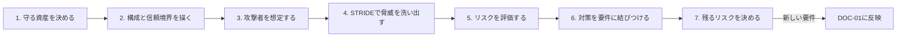
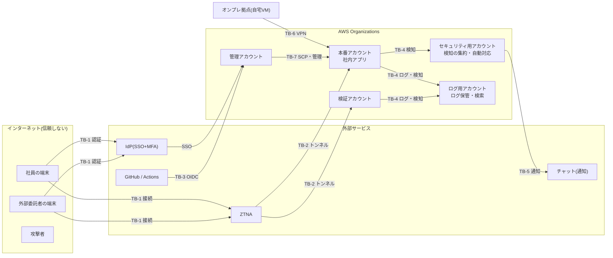

# 脅威分析書:架空の小さな会社「ミナト企画」のゼロトラスト化

| 項目 | 内容 |
|---|---|
| 文書番号 | DOC-02 |
| 版 | 0.1(初版ドラフト) |
| 作成日 | 2026-11-18 |
| 作成者 | (自分の名前) |
| 関連文書 | DOC-01 要件定義書 |
| 状態 | レビュー前 |

### 改版履歴
| 版 | 日付 | 内容 |
|---|---|---|
| 0.1 | 2026-11-18 | 初版 |

---

## 1. 目的と範囲

### 1.1 目的
- 要件定義書(DOC-01)で決めた対象について、**どんな脅威があり、どれくらい危ないか** を洗い出す
- 脅威ごとに **どの要件で防ぐか(または受け入れるか)** を決め、要件の抜けを見つける
- 方式設計で「なぜこの対策を選んだか」を説明する根拠にする

### 1.2 範囲
DOC-01 の対象範囲(S-1〜S-8)と、構築・運用に使う GitHub、GitHub Actions、Terraform を含めます。DOC-01 の「対象外」(MDM/EDR製品、メールゲートウェイなど)は分析しますが、対策はこの範囲の中で考えます。

---

## 2. 分析の進め方

- **脅威の洗い出し:** STRIDE(なりすまし・改ざん・否認・情報漏えい・サービス妨害・権限昇格)を、構成要素ごとに当てはめる
- **攻撃手法の参照:** MITRE ATT&CK の手法ID を付け、検知ルールや GuardDuty の検知結果と対応づけやすくする
- **リスク評価:** 対策をする前の「固有リスク」を、可能性 × 影響で評価する

### 2.1 リスクの評価基準
| 点 | 可能性 | 影響 |
|---|---|---|
| 3 | 高:無差別な攻撃や日常的なミスで、1年以内に起こりうる | 大:顧客情報の漏えい、業務の停止、10万円以上の損失 |
| 2 | 中:条件がそろえば起こりうる | 中:社内情報の漏えい、半日程度の業務への影響 |
| 1 | 低:狙われない限り起こりにくい | 小:影響が限られ、すぐ元に戻せる |

| リスク | 点数(可能性 × 影響) | 対応方針 |
|---|---|---|
| 高 | 6〜9 | P1またはP2で必ず対策する |
| 中 | 3〜4 | 対策するか、理由を書いて受け入れる |
| 低 | 1〜2 | 受け入れてよい。運用で様子を見る |

---

## 3. 守る資産

| ID | 資産 | 置き場所 | 機密性 | 完全性 | 可用性 | 理由 |
|---|---|---|---|---|---|---|
| A-01 | 顧客情報・請求情報(社内アプリのデータ) | AWS 本番 | 高 | 高 | 中 | 漏れると取引先の信頼と法的責任に関わる |
| A-02 | 利用者のID・認証情報 | IdP | 高 | 高 | 高 | 乗っ取られるとすべてに入られる |
| A-03 | AWSの管理権限 | 管理アカウント、IAM Identity Center | 高 | 高 | 中 | 環境全体を操作できる |
| A-04 | ログ(操作記録・検知結果) | AWS ログ用アカウント | 中 | **高** | 中 | 事故の調査の証拠。改ざんされると追えない |
| A-05 | 検知・自動対応の仕組み | AWS セキュリティ用アカウント | 中 | 高 | 高 | 止められると攻撃に気づけない |
| A-06 | ZTNAのアクセスポリシー | ZTNAサービス | 中 | 高 | 高 | 誤ると誰でも社内アプリに入れる |
| A-07 | Terraformのコード・状態ファイル | GitHub、S3 | 高 | 高 | 中 | 構成の情報や秘密情報を含む |
| A-08 | CI/CDの実行権限 | GitHub Actions | 高 | 高 | 低 | AWSを変更できる |
| A-09 | ダッシュボード・通知 | ログ基盤、チャット | 中 | 中 | 中 | 弱点の一覧は攻撃者にとっての地図になる |
| A-10 | AWSの利用料金 | 全アカウント | ― | ― | ― | 悪用されると高額請求になる(個人負担) |

---

## 4. 構成と信頼境界

方式設計の前なので、製品名は入れずに役割だけで描いています。

| ID | 信頼境界 | 越えるもの | 主な確認 |
|---|---|---|---|
| TB-1 | 端末 ↔ IdP・ZTNA | 利用者の認証、アプリへの接続 | ID、MFA、(可能なら)端末の状態 |
| TB-2 | ZTNA ↔ 社内アプリ | 認証済みの通信 | アプリ単位の許可、内側からだけ張るトンネル |
| TB-3 | GitHub Actions ↔ AWS | インフラの変更 | OIDCの信頼条件(リポジトリ・ブランチ) |
| TB-4 | 業務用アカウント ↔ ログ・セキュリティ用アカウント | ログ、検知結果 | 書き込みだけ許可、業務用アカウントからは消せない |
| TB-5 | AWS ↔ チャット | 通知内容 | 通知に載せる情報を絞る |
| TB-6 | オンプレ ↔ AWS | 拠点間の通信 | 暗号化、宛先とポートの制限 |
| TB-7 | 管理アカウント ↔ 他のアカウント | 組織のルール | SCP、管理アカウントを普段使わない |

---

## 5. 想定する攻撃者

| ID | 攻撃者 | 目的 | 能力 | 想定する入口 |
|---|---|---|---|---|
| AT-1 | 無差別な外部の攻撃者 | 金銭(マイニング、ランサムウェア、情報の売買) | 中:自動化ツール、漏れたキーの探索 | 公開されたキー、パスワードスプレー、公開サーバー |
| AT-2 | 取引先を狙う標的型の攻撃者 | 取引先に入るための足がかり | 中〜高:フィッシング、中間者型フィッシング | 社員へのフィッシングメール |
| AT-3 | 退職者・契約が終わった外部委託者 | 不満、情報の持ち出し | 低〜中:社内の事情を知っている | 消し忘れたアカウント |
| AT-4 | 社員・管理者の不注意 | (悪意なし) | ― | 設定ミス、キーのコミット、ポリシーの誤り |

小さな会社なので、国家レベルの攻撃者(APT)は対象外とします。AT-4 は攻撃者ではありませんが、発生件数が最も多いと考えて含めます。

---

## 6. 脅威の一覧(STRIDE)

- **分類:** DOC-01 の脅威の大分類(T-01〜)。この分析で T-10〜T-12 を追加しました(6.2)
- **L / I / R:** 可能性 / 影響 / リスク(固有リスク)
- **対策:** DOC-01 の要件ID。**太字** は、この分析で追加した要件です(8章)

### 6.1 一覧

#### ID基盤(IdP・SSO)
| ID | S/T/R/I/D/E | 脅威 | ATT&CK | L | I | R | 対策 | 分類 |
|---|---|---|---|---|---|---|---|---|
| TH-01 | S | 中間者型フィッシングで、パスワードとMFAのコードを同時に盗まれる | T1566, T1557 | 3 | 3 | **9 高** | FR-ID-02, **FR-ID-09**, FR-AC-04 | T-01 |
| TH-02 | S | パスワードスプレー(よくあるパスワードを多数のIDで試す) | T1110.003 | 3 | 2 | **6 高** | FR-ID-02, FR-LG-01 | T-01 |
| TH-03 | S | MFA疲労攻撃(承認の通知を何度も送り、うっかり承認させる) | T1621 | 2 | 3 | **6 高** | **FR-ID-09** | T-01 |
| TH-04 | E | 退職者・契約が終わった外部委託者のアカウントが残る | T1078 | 2 | 2 | 4 中 | FR-ID-06, FR-ID-07, NFR-OPS-03 | T-02 |
| TH-05 | R | IdPの設定変更(MFAの解除など)の記録がなく、誰がやったか分からない | ― | 2 | 2 | 4 中 | FR-LG-01 | T-06 |
| TH-06 | D | IdPの障害で、全員がすべてのサービスに入れなくなる | ― | 1 | 3 | 3 中 | FR-ID-08 | T-12 |

#### アクセス制御(ZTNA)・社内アプリ・端末
| ID | S/T/R/I/D/E | 脅威 | ATT&CK | L | I | R | 対策 | 分類 |
|---|---|---|---|---|---|---|---|---|
| TH-07 | S | 盗まれたセッションクッキーで、MFAなしに社内アプリへ入られる | T1539 | 2 | 3 | **6 高** | **FR-AC-07**, FR-AC-06 | T-01 |
| TH-08 | T | ZTNAのポリシーを誤って変え、誰でも社内アプリに入れてしまう | ― | 2 | 3 | **6 高** | NFR-MNT-01, NFR-MNT-02, FR-AC-05 | T-04 |
| TH-09 | D | ZTNAサービスの障害で、社内アプリに入れない | ― | 1 | 2 | 2 低 | FR-ID-08(受け入れる。8章) | T-12 |
| TH-10 | I | 外部委託者が、本番アプリや顧客情報を見る | T1078 | 2 | 3 | **6 高** | FR-AC-03, FR-ID-03 | T-08 |
| TH-11 | E | 社内アプリの脆弱性を突かれる | T1190 | 2 | 3 | **6 高** | FR-AC-02(インターネットに出さない)、FR-DT-03 | T-05 |
| TH-12 | I | アプリのSSRFを使い、インスタンスメタデータからAWSの認証情報を盗む | T1552.005 | 2 | 3 | **6 高** | **FR-DT-08**, FR-DT-03 | T-04 |
| TH-13 | E | 感染した端末から、社内アプリやほかのシステムに被害が広がる | T1021 | 2 | 3 | **6 高** | FR-AC-02, FR-AC-03, FR-RS-04 | T-05 |

#### AWSアカウント・IAM・データ
| ID | S/T/R/I/D/E | 脅威 | ATT&CK | L | I | R | 対策 | 分類 |
|---|---|---|---|---|---|---|---|---|
| TH-14 | S | アクセスキーがGitHubなどに漏れ、悪用される | T1552.001, T1078.004 | 3 | 3 | **9 高** | FR-ID-04, NFR-SEC-01, NFR-SEC-02, FR-RS-03 | T-03 |
| TH-15 | S | ルートユーザーを乗っ取られる | T1078.004 | 1 | 3 | 3 中 | FR-ID-05, **FR-RS-07** | T-01 |
| TH-16 | E | 乗っ取ったIDで、新しいIAMユーザーやキーを作って居座る | T1136.003, T1098.001 | 2 | 3 | **6 高** | **FR-DT-09**, FR-DT-03, FR-RS-01 | T-01 |
| TH-17 | D | 盗んだ認証情報で暗号資産のマイニングをされ、高額請求が来る | T1496 | 3 | 2 | **6 高** | NFR-COST-02, FR-DT-03, FR-DT-06 | T-09 |
| TH-18 | I | S3バケットの公開設定のミスで、データが漏れる | T1530 | 2 | 3 | **6 高** | **FR-DT-08**, FR-DT-04, FR-DT-05 | T-04 |
| TH-19 | I | セキュリティグループの全開放で、サーバーが攻撃にさらされる | T1190 | 3 | 2 | **6 高** | FR-RS-02 | T-04 |
| TH-20 | I | スナップショットの共有などで、別のAWSアカウントにデータを持ち出される | T1537 | 1 | 3 | 3 中 | FR-DT-03, FR-DT-05 | T-04 |

#### ログ・検知・自動対応・通知
| ID | S/T/R/I/D/E | 脅威 | ATT&CK | L | I | R | 対策 | 分類 |
|---|---|---|---|---|---|---|---|---|
| TH-21 | T/R | 攻撃者がCloudTrailを止めたり、ログを消したりして痕跡を隠す | T1562.008 | 2 | 3 | **6 高** | FR-DT-06, FR-LG-02, NFR-LOG-03 | T-06 |
| TH-22 | T | GuardDutyやSecurity Hubを無効にされる | T1562.001 | 2 | 3 | **6 高** | **FR-DT-09**, **FR-RS-07** | T-06 |
| TH-23 | D | アラートが多すぎて、重要なものが埋もれる(アラート疲れ) | ― | 3 | 2 | **6 高** | NFR-OPS-02, **FR-RS-08** | T-07 |
| TH-24 | R | 検知されたが、誰も対応しないまま放置される | ― | 3 | 3 | **9 高** | FR-RS-01, FR-DB-02, FR-DB-03 | T-07 |
| TH-25 | E | 自動対応のLambdaの権限が広すぎて、乗っ取られたときに悪用される | T1078.004 | 1 | 3 | 3 中 | NFR-SEC-05 | T-10 |
| TH-26 | D | 自動対応が誤って動き、正しく使っているリソースを止めてしまう | ― | 2 | 2 | 4 中 | FR-RS-06, **FR-RS-08** | T-10 |
| TH-27 | I/S | 通知用のWebhook URLが漏れ、偽の通知を送られる。通知の中身から構成が漏れる | ― | 2 | 1 | 2 低 | NFR-SEC-01、通知内容を絞る(方式設計) | T-03 |
| TH-28 | I | ダッシュボードを誰でも見られ、弱点の一覧が漏れる | ― | 2 | 2 | 4 中 | FR-AC-03(ダッシュボードもZTNA経由にする) | T-08 |

#### GitHub・CI/CD・Terraform・オンプレ接続
| ID | S/T/R/I/D/E | 脅威 | ATT&CK | L | I | R | 対策 | 分類 |
|---|---|---|---|---|---|---|---|---|
| TH-29 | E | OIDCの信頼条件が緩く、他人のリポジトリからAWSを操作される | T1078.004 | 2 | 3 | **6 高** | NFR-SEC-02, **NFR-SEC-06** | T-11 |
| TH-30 | T | 悪意のあるGitHub ActionやTerraformのプロバイダーで、AWSを操作される | T1195 | 1 | 3 | 3 中 | **NFR-SEC-06** | T-11 |
| TH-31 | I | Terraformの状態ファイルに秘密情報が平文で入っていて、漏れる | T1552.001 | 2 | 3 | **6 高** | NFR-SEC-03, NFR-SEC-04 | T-03 |
| TH-32 | E | オンプレ拠点の感染が、VPN経由でAWSに広がる | T1021 | 1 | 3 | 3 中 | **FR-HY-03** | T-05 |

### 6.2 追加した脅威の大分類
DOC-01 の T-01〜T-09 に、次の3つを追加します。

| ID | 脅威の大分類 | 追加した理由 |
|---|---|---|
| T-10 | 自動対応の仕組みそのものの悪用・誤作動 | 自動化を進めるほど、自動化の仕組みが新しい攻撃対象と障害の原因になるため |
| T-11 | 構築に使う道具(CI/CD、IaC)を経由した侵害 | コードで管理すると、GitHubやActionsが本番を変更できる入口になるため |
| T-12 | IdP・ZTNAなど外部サービスの障害・侵害 | ゼロトラストでは、IdPとZTNAが止まると全員が仕事できなくなるため |

### 6.3 リスクの分布(固有リスク)

| 可能性 \ 影響 | 小(1) | 中(2) | 大(3) |
|---|---|---|---|
| **高(3)** | ― | TH-02, 17, 19, 23 | **TH-01, 14, 24** |
| **中(2)** | TH-27 | TH-04, 05, 26, 28 | TH-03, 07, 08, 10, 11, 12, 13, 16, 18, 21, 22, 29, 31 |
| **低(1)** | ― | TH-09 | TH-06, 15, 20, 25, 30, 32 |

最もリスクが高いのは次の3つです。いずれもP1(応募時点)で対策します。
- **TH-01 フィッシングによるアカウント乗っ取り** → ゼロトラストの入口であるIDを守る
- **TH-14 アクセスキーの漏えい** → 長期のキーを作らない
- **TH-24 アラートの放置** → 人の注意力に頼らない通知とエスカレーション

---

## 7. 攻撃シナリオ

一覧だけでは「対策がどう効くか」が見えにくいので、代表的な流れを3つ書きます。**どこで止めるか(予防)** と **どこで気づくか(検知)** を分けています。

### シナリオ A:アクセスキーの漏えいからマイニングへ(AT-1, AT-4)
| 段階 | 攻撃者の行動 | 予防(止める) | 検知(気づく) |
|---|---|---|---|
| 1 | 開発者がアクセスキーを含むファイルをGitHubに公開する | 長期キーを作らない(FR-ID-04)、コミット前の検査、Push Protection(NFR-SEC-01) | ― |
| 2 | 攻撃者が自動ツールで公開キーを見つける | ― | ― |
| 3 | 権限を調べ、IAMユーザーを追加して居座る | SCPでIAMユーザーの作成を禁止(FR-DT-09) | GuardDuty(FR-DT-03) |
| 4 | 使っていないリージョンで大量のEC2を起動する | SCPでリージョンを制限(FR-DT-06) | GuardDuty、Cost Anomaly Detection(NFR-COST-02) |
| 5 | ― | キーを自動で無効にする(FR-RS-03) | 15分以内に通知(FR-RS-01) |

→ **1で止まるのが理想。** 止まらなくても、3〜4で検知し、5で自動対応する多層防御にします。

### シナリオ B:フィッシングから顧客情報の持ち出しへ(AT-2)
| 段階 | 攻撃者の行動 | 予防(止める) | 検知(気づく) |
|---|---|---|---|
| 1 | 営業に偽のログイン画面のメールを送る | フィッシング耐性のあるMFA(FR-ID-09) | ― |
| 2 | パスワードとセッションを盗む(中間者型) | 偽サイトではパスキーが動かない(FR-ID-09) | IdPのサインインログ(FR-LG-01) |
| 3 | 盗んだセッションで社内アプリに入る | セッションの有効期間を短くする(FR-AC-07)、端末の条件(FR-AC-06) | ZTNAのアクセスログ(FR-AC-05) |
| 4 | 顧客情報を大量にダウンロードする | 営業の権限は顧客管理だけ(FR-AC-03) | ログ基盤での普段と違うアクセスの検知(FR-LG-01) |

→ 2の **パスキー** が最も効く対策です。ここが「パスワード+ワンタイムコード」のままだと、3以降に進まれます。

### シナリオ C:ログを消して痕跡を隠す(AT-1, AT-2)
| 段階 | 攻撃者の行動 | 予防(止める) | 検知(気づく) |
|---|---|---|---|
| 1 | 何らかの方法で本番アカウントの管理者権限を得る | 最小権限(FR-ID-03)、管理者権限は必要なときだけ(FR-ID-08) | GuardDuty(FR-DT-03) |
| 2 | CloudTrailを止め、GuardDutyを無効にしようとする | SCPで禁止(FR-DT-06, FR-DT-09)、委任管理者で一括管理(FR-DT-03) | 停止の操作を即時通知(FR-RS-07) |
| 3 | 既にあるログを消そうとする | ログは別アカウントに置き、削除できない設定(FR-LG-02) | ― |

→ **本番アカウントの管理者になっても、ログと検知には手が届かない** ことが、アカウントを分ける理由です。

---

## 8. リスクへの対応方針と残るリスク

### 8.1 対応方針
| 方針 | 対象 |
|---|---|
| 低減(対策する) | リスクが「高」のすべての脅威と、「中」の大部分 |
| 回避(やめる) | IAMユーザーの長期アクセスキー(作らない)、社内アプリのインターネット公開(しない) |
| 移転(外に任せる) | IdP・ZTNA・検知の基盤はマネージドサービスやSaaSを使い、運用を任せる |
| 受容(受け入れる) | 下の表(8.2) |

### 8.2 受け入れるリスク(残存リスク)
| # | 残るリスク | 受け入れる理由 | 代わりの対策 |
|---|---|---|---|
| RR-1 | 端末がマルウェアに感染する(EDRがない) | 費用と運用の負担が大きく、対象外にした(DOC-01 2.2) | ZTNAでアクセスできる範囲を最小にし、被害を広げない |
| RR-2 | IdPやZTNAのサービス自体が侵害・停止する(TH-06, TH-09) | 自前で作るより、専門の事業者に任せる方が安全で安い | 緊急用アカウントと手順を用意する(FR-ID-08) |
| RR-3 | 正しい権限を持つ代表・情報システム担当による不正 | 10人の会社で職務を完全に分けるのは難しい | すべての操作をログに残し、後から追えるようにする |
| RR-4 | 未知の脆弱性(ゼロデイ) | 予防できない | 検知と自動対応で被害を小さくする |
| RR-5 | 盗まれたセッションが、有効期間の間は使われる(TH-07) | 期間をゼロにはできない | 有効期間を短くし、本番アプリは再認証を求める |

---

## 9. 要件定義書(DOC-01)への反映

この分析で見つかった不足を、DOC-01 に追加しました(DOC-01 v0.2)。

| 追加した要件 | 内容 | 優先度 | フェーズ | 理由(脅威) |
|---|---|---|---|---|
| FR-ID-09 | 管理者はフィッシング耐性のあるMFA(パスキー/FIDO2)を使う。ほかの社員にも推奨する | Should | P1 | TH-01, TH-03 |
| FR-AC-07 | ZTNAのセッション有効期間を短くし、本番アプリは再認証を求める | Should | P2 | TH-07 |
| FR-DT-08 | 予防的な基本設定(IMDSv2の必須化、アカウント単位のS3ブロックパブリックアクセス、EBSの暗号化)を全アカウントにかける | Must | P1 | TH-12, TH-18 |
| FR-DT-09 | SCPで、セキュリティサービスの無効化とIAMユーザー・アクセスキーの作成を禁止する(緊急用を除く) | Should | P1 | TH-16, TH-22 |
| FR-RS-07 | ルートユーザーのログイン、ログやセキュリティサービスの停止を、すぐに通知する | Must | P1 | TH-15, TH-21, TH-22 |
| FR-RS-08 | 自動対応から外すための例外(タグなど)と、誤検知を抑えるルールを持つ | Should | P2 | TH-23, TH-26 |
| FR-HY-03 | オンプレ拠点からAWSへは、必要な宛先とポートだけを許可する | Could | P2 | TH-32 |
| NFR-SEC-06 | GitHub Actionsのアクションはコミットハッシュで固定し、OIDCの信頼条件はリポジトリとブランチで絞る | Must | P1 | TH-29, TH-30 |

---

## 10. 見直しのタイミング
- 方式設計(製品の選定)が終わったとき:製品ごとの脅威(例:Cloudflare Tunnel、Tailscaleの鍵の管理)を追加する
- 構成を大きく変えたとき(P2・P3の追加時)
- 月次の振り返り(NFR-OPS-04)で、実際の検知から新しい脅威が見つかったとき

> 注:ATT&CK の手法IDは、MITRE ATT&CK の公開時点の版をもとにしています。ブログや面接で使う前に、公式サイトで最新の版を確認してください。
