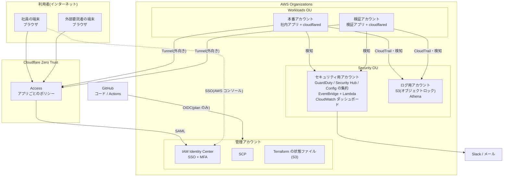
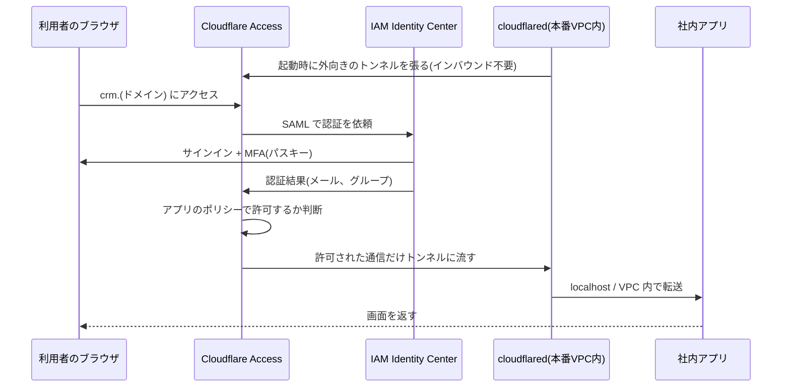
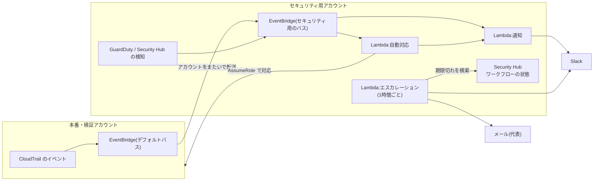

# 方式設計書:架空の小さな会社「ミナト企画」のゼロトラスト化

| 項目 | 内容 |
|---|---|
| 文書番号 | DOC-03 |
| 版 | 0.1(初版ドラフト) |
| 作成日 | 2026-11-18 |
| 作成者 | (自分の名前) |
| 関連文書 | DOC-01 要件定義書(v0.2)、DOC-02 脅威分析書(v0.1) |
| 状態 | レビュー前 |

### 改版履歴
| 版 | 日付 | 内容 |
|---|---|---|
| 0.1 | 2026-11-18 | 初版 |

> **「要確認」の付いた項目:** 料金、無料枠、サービスの仕様は変わることがあります。構築の前に公式ドキュメントで確認し、結果をこの文書に反映します。
> **「検証項目」の付いた項目:** 実際に動かして確かめるまで確定しない設計です(12章)。

---

## 1. 目的
DOC-01 の要件と DOC-02 の脅威への対策を、**どの製品・サービスで、どう組み合わせて実現するか** を決めます。あわせて、方式を選んだ理由と、別の選択肢を選ばなかった理由を残します。

---

## 2. 方式の選定(DOC-01 13章の未決事項への回答)

各項目は「候補 → 評価 → 決定 → 理由」の順に書きます。評価の観点は次の4つです。

- **要件:** DOC-01 の要件を満たせるか
- **費用:** 月額費用が目標(月3,000円以内)に収まるか
- **運用:** 情報システム担当1人が週2時間で回せるか(NFR-OPS-01)
- **拡張性:** 人やアカウントが増えても、そのまま使えるか

評価の記号:◎ とても良い / ○ 良い / △ 課題あり / × 満たせない

### 2.1 Q-1:IdP をどこに置くか
| 観点 | A. IAM Identity Center を IdP にする | B. Entra ID を IdP にして AWS と ZTNA に SSO |
|---|---|---|
| 要件 | ○ SSO、MFA(FIDO2対応)、グループごとの権限を満たす | ◎ 条件付きアクセスまで使えば、より細かく制御できる |
| 費用 | ◎ 追加費用なし | △ 条件付きアクセスや自動プロビジョニングは有料ライセンスが必要(要確認) |
| 運用 | ◎ AWS の中で完結し、Terraform で管理できる | △ AWS と Microsoft の2か所を管理することになる |
| 拡張性 | ○ SAML で外部アプリにも SSO できる | ◎ Microsoft 365 などの SaaS とまとめて管理できる |

**決定:A. IAM Identity Center を IdP にする。** Cloudflare Access には SAML アプリとしてつなぎます。

**理由**
- この会社は Microsoft 365 を使っていないので、Entra ID を入れるだけのために別の管理基盤を増やすことになる
- 無料で FIDO2(パスキー)の MFA を使えるため、FR-ID-09 を満たせる
- 退職時は Identity Center の1か所で止めれば、AWS と ZTNA の両方に入れなくなる(FR-ID-07)

**お客様に提案する場合:** Microsoft 365 を使っている会社や、端末の状態をアクセスの条件にしたい会社(FR-AC-06 を重視する会社)には、B を提案します。

### 2.2 Q-2:ZTNA の製品
| 観点 | A. Cloudflare Zero Trust(Access + Tunnel) | B. Tailscale |
|---|---|---|
| 要件 | ◎ アプリ単位でアクセスのたびに IdP の認証を確認する(L7)。アクセスログが残る | ○ 端末どうしをつなぐネットワーク(L3)。アプリ単位の制御は ACL で行う |
| 費用 | ◎ 50ユーザーまで無料(要確認) | × 無料の個人向けプランは3ユーザーまで(要確認)。11人では有料になる |
| 運用 | ○ サーバー側は Tunnel を置くだけ。インバウンドのポートを開けなくてよい | ○ 各端末にクライアントを入れる |
| 拡張性 | ◎ ブラウザだけで使え、外部委託者の端末に何も入れなくてよい | △ 外部委託者の端末にもクライアントを入れる必要がある |

**決定:A. Cloudflare Zero Trust。**

**理由**
- 「アクセスのたびに、人を確認してアプリ単位で許可する」というゼロトラストの方針(P-2、P-3)に最も近い
- ブラウザで使えるため、外部委託者の端末を管理しなくても、検証アプリだけを見せられる(UC-2)
- Tunnel は内側から外向きに接続するため、社内アプリのインバウンドを一切開けなくてよい(FR-AC-02)

**必要なもの:** Cloudflare で管理する独自ドメイン(年1,000〜2,000円程度。要確認)

### 2.3 Q-3:マルチアカウントの作り方
| 観点 | A. Organizations + Terraform で自分で作る | B. Control Tower を使う |
|---|---|---|
| 要件 | ○ 必要なものを選んで作る | ◎ 推奨構成がまとめて手に入る |
| 費用 | ◎ 必要なものだけ有効にする | △ Config などが全アカウントで自動的に有効になり、費用を絞りにくい |
| 運用 | ○ すべて Terraform のコードで管理できる | △ Control Tower が作るリソースと Terraform の管理範囲が重なりやすい |
| 拡張性 | ○ モジュール化すれば増やせる | ◎ Account Factory で増やしやすい |

**決定:A. Organizations + Terraform。**

**理由**
- 費用を目標内に収めるには、Config の記録対象などを細かく絞る必要がある(NFR-COST-01)
- 5アカウントの小さな構成では、Control Tower の自動化の利点よりも、管理の重なりの方が問題になる

**お客様に提案する場合:** アカウントが20を超える会社や、部署ごとにアカウントを配る会社には、B を提案します。

### 2.4 Q-4:ログ集約の場所
| 観点 | A. OpenSearch Service | B. Wazuh | C. S3(保管)+ Athena(検索) |
|---|---|---|---|
| 要件 | ◎ 検索と可視化が強い | ◎ SIEM の機能がそろっている | ○ SQL で検索できる。リアルタイムの分析は弱い |
| 費用 | × 常時起動で月数千円以上(要確認) | ○ 自宅VMなら無料。EC2 ではメモリが大きく高い | ◎ 保存量とスキャン量に応じた料金だけ |
| 運用 | △ ドメインのサイズやバージョンの管理が要る | △ サーバーの運用が要る | ◎ サーバーがない |
| 拡張性 | ◎ | ○ | ○ |

**決定:C. S3 + Athena を基本にする。** B. Wazuh(自宅VM)は、余裕があれば P3 で追加します。

**理由**
- 小さな会社では、ログを検索するのは事故のときと月次の振り返りのときが中心で、常時動くサーバーは過剰
- ログ用アカウントの S3 は、改ざん・削除を防ぐ保管場所(FR-LG-02)も兼ねられる
- 検知と通知は GuardDuty と Security Hub が担うので、ログ基盤にリアルタイムの検知を求めなくてよい

### 2.5 Q-5:ダッシュボードとアラート管理
| 観点 | A. CloudWatch ダッシュボード + Security Hub のワークフロー | B. OpenSearch Dashboards / Wazuh | C. QuickSight / Grafana |
|---|---|---|---|
| 要件 | ○ 3観点の指標を表示できる。アラートの状態は Security Hub で管理する | ◎ | ◎ |
| 費用 | ◎ ダッシュボード3つと独自メトリクス10個は無料枠(要確認) | 2.4 と同じ | △ 利用者ごとの課金、またはサーバーが要る |
| 運用 | ◎ AWS の中で完結する | △ | △ |

**決定:A. CloudWatch ダッシュボード(「リスク」「脅威」「対応状況」の3枚)+ Security Hub のワークフローの状態。**

**理由**
- 無料枠の「ダッシュボード3つ」が、ちょうど3観点に当てはまる
- アラートの状態(未対応 / 対応中 / 完了)は、Security Hub の検知結果が持つワークフローの状態(NEW / NOTIFIED / RESOLVED / SUPPRESSED)をそのまま使う。別のチケット管理システムを持たなくてよい
- 代表は、SSO で読み取り専用の権限を使ってダッシュボードを見る(ZTNA と同じ IdP の認証を通る)

### 2.6 Q-6:通知先
**決定:Slack(Incoming Webhook)を基本にし、エスカレーションはメール(SNS)にも送る。**

**理由**
- 日常の通知はチャットの方が気づきやすく、対応の相談もその場でできる
- エスカレーションは「確実に届くこと」を優先し、別の経路(メール)にも送る
- Webhook の URL は SSM Parameter Store の SecureString に置き、コードに書かない(TH-27)

### 2.7 Q-7:数値目標
DOC-01 の(仮)の値をそのまま使います。11章の概算費用を確認してから確定します。

### 2.8 決定のまとめ
| 項目 | 決定 |
|---|---|
| IdP | AWS IAM Identity Center(MFA は FIDO2 を基本) |
| ZTNA | Cloudflare Zero Trust(Access + Tunnel) |
| マルチアカウント | AWS Organizations(5アカウント)+ SCP、Control Tower は使わない |
| 検知 | GuardDuty、Security Hub、Config、IAM Access Analyzer(セキュリティ用アカウントに委任) |
| ログ | 組織の CloudTrail → ログ用アカウントの S3(オブジェクトロック)、検索は Athena |
| 自動対応 | EventBridge → Lambda(セキュリティ用アカウントに集約) |
| ダッシュボード | CloudWatch ダッシュボード3枚、アラート管理は Security Hub のワークフロー |
| 通知 | Slack + メール(SNS) |
| IaC | Terraform(状態ファイルは S3、ネイティブのロック) |

---

## 3. 全体構成



---

## 4. AWS アカウントと組織のルール

### 4.1 アカウント構成
| アカウント | OU | 役割 | 置くもの |
|---|---|---|---|
| 管理 | Root | 組織の管理だけ。普段は使わない | Organizations、SCP、IAM Identity Center、Terraform の状態ファイル、Budgets |
| セキュリティ | Security | 検知と対応の集約(委任管理者) | GuardDuty・Security Hub・Config・Access Analyzer の委任管理者、自動対応の Lambda、ダッシュボード |
| ログ | Security | ログの保管。誰も書き換えられない | CloudTrail と Config の保存先 S3、Athena |
| 本番 | Workloads | 社内アプリ | VPC、EC2(アプリ + cloudflared) |
| 検証 | Workloads | 開発・外部委託者の作業 | VPC、EC2(検証アプリ + cloudflared) |

- 各アカウントには別のメールアドレスが必要。メールのエイリアス(+記号など)を使う
- **(確認済み・V-1)** 2025年7月以降の「無料プラン」のアカウントは Organizations を使えない(参加すると有料プランに切り替わり、無料枠のクレジットが使えなくなる)。そのため、管理アカウントは最初から「有料プラン」で作る。有料プランでも最大200 USD のクレジットがあり、作成から12か月有効

### 4.2 SCP(組織のルール)
| SCP | 対象 | 内容 | 要件 |
|---|---|---|---|
| scp-region-restrict | Workloads OU、Security OU | 東京リージョン以外の利用を禁止(グローバルサービスは除く) | FR-DT-06 |
| scp-protect-security | Workloads OU、Security OU | CloudTrail の停止・削除、GuardDuty・Security Hub・Config の無効化を禁止 | FR-DT-06, FR-DT-09 |
| scp-deny-iam-user | Security OU、Workloads OU | IAM ユーザーとアクセスキーの作成を禁止(Security OU にも付けて、より強くした) | FR-DT-09, FR-ID-04 |
| scp-protect-logs | Security OU(ログ用アカウント) | ログ用 S3 の削除、オブジェクトロック・ポリシーの変更を禁止 | FR-LG-02 |
| scp-deny-leave-org | Root 配下すべて | 組織からの離脱を禁止 | FR-DT-06 |

- SCP は管理アカウントには効かないため、管理アカウントは普段使わない
- SCP には、Terraform が使う管理用ロールを例外として入れる(入れないと Terraform 自身が止められる)

### 4.3 全アカウント共通の予防的な設定(FR-DT-08)
- EC2 の IMDSv2 を必須にする(アカウントのデフォルト設定)
- S3 のブロックパブリックアクセスを、アカウント単位で有効にする
- EBS のデフォルト暗号化を有効にする
- IAM のパスワードポリシー(IAM ユーザーは作らないが、念のため)

---

## 5. ID 基盤(IAM Identity Center)

### 5.1 グループと権限
| グループ | メンバー | AWS の権限(許可セット) | Cloudflare Access で使えるアプリ |
|---|---|---|---|
| g-it-admin | 情報システム担当 | 全アカウント:AdministratorAccess(セッション1時間) | すべて |
| g-executive | 代表 | セキュリティ:DashboardViewer(読み取り) | 顧客管理、経理、Wiki |
| g-developer | 開発 | 検証:Developer / 本番:ReadOnlyAccess | Wiki、検証アプリ |
| g-sales | 営業 | なし | 顧客管理、Wiki |
| g-backoffice | 経理・総務 | なし | 経理、Wiki |
| g-contractor | 外部委託者 | なし | 検証アプリだけ |

- 営業・経理・外部委託者には AWS の権限を渡さない(必要なのはアプリだけ)
- DashboardViewer は、CloudWatch のダッシュボードとメトリクスの読み取りだけを許す独自の許可セット

### 5.2 MFA
- MFA は「サインインのたびに必須」にする
- MFA の種類は FIDO2(パスキー、セキュリティキー)を基本にする(FR-ID-09)
- **(確認済み・V-3)** 認証アプリ(ワンタイムコード)のチェックを外し、**FIDO2(セキュリティキーと組み込みの認証ツール)だけ** にできた。全員を FIDO2 だけにする(2026-11-20 設定)
  - 理由:ワンタイムコードは偽のサイトに入力させて盗めるが、FIDO2 は本物のサイトでしか動かないため、フィッシングに強い(DOC-02 TH-01, TH-03)
- **(要確認)** MFA の設定は Terraform で管理できない可能性がある。今は画面で設定しており、手動の手順として運用手順書に書く

### 5.3 外部委託者の期限(FR-ID-06)
- 外部委託者の利用期限を、SSM Parameter Store に「ユーザー名と期限」として登録する
- 毎日1回動く Lambda が、期限を過ぎたユーザーを g-contractor から外し、Slack に通知する

### 5.3a Identity Center のリージョン
| 候補 | 内容 | 判断 |
|---|---|---|
| 単一リージョン(東京) | インスタンスを東京だけに置く | **採用** |
| マルチリージョン(東京 + オレゴンに複製) | 東京の障害時もサインインできる | 不採用 |

**理由**
- 利用者の情報を東京だけに置き、「東京リージョンを基本にする」という前提(DOC-01 9章)とそろえる
- 小さな会社では、東京リージョン全体の障害は「受け入れるリスク」(DOC-02 RR-2)とし、緊急用アカウント(5.4)で対応する
- 構成と運用を単純に保つ

**お客様に提案する場合:** 社員が多く、サインインが止まると業務への影響が大きい会社には、マルチリージョンを提案する。

### 5.3b メンバーアカウントのルートユーザー
- IAM の「ルートアクセスの一元管理」(RootCredentialsManagement、RootSessions)を有効にする(P2-1)
- メンバーのルートには認証情報(パスワード・アクセスキー・MFA)を持たせない。パスワードの再設定もできない
- ルートでしかできない作業が必要なときは、管理アカウントから短時間のルートのセッション(`sts:AssumeRoot`)を使う
- そのため、メンバーのルートに MFA を付ける必要はない(Security Hub がルートの MFA を指摘した場合は、この設計を理由に扱いを決める)

### 5.4 緊急用アカウント(FR-ID-08)
- Identity Center が使えないときは、管理アカウントのルートユーザー(ハードウェアの MFA)を使う
- ルートユーザーのログインは、すぐに通知される(FR-RS-07)ので、使ったら理由を記録する

---

## 6. アクセス制御(Cloudflare Zero Trust)

### 6.1 接続の仕組み


### 6.2 アプリとポリシー
| アプリ | URL(例) | 置き場所 | 許可するグループ | セッションの有効期間 |
|---|---|---|---|---|
| 顧客管理 | crm.(ドメイン) | 本番 | g-sales, g-executive, g-it-admin | 8時間 |
| 経理 | accounting.(ドメイン) | 本番 | g-backoffice, g-executive, g-it-admin | 8時間 |
| Wiki | wiki.(ドメイン) | 本番 | 外部委託者以外の全員 | 24時間 |
| 検証アプリ | dev.(ドメイン) | 検証 | g-developer, g-contractor, g-it-admin | 8時間 |

- ポリシーは Terraform の Cloudflare プロバイダーで管理し、変更はプルリクエストで確認する(TH-08)
- **再認証(FR-AC-07、TH-07):** 上の表の「セッションの有効期間」は、アプリごとのセッション。これが切れたあと、パスキーで確かめ直させるため、次の2つも短くする。どちらかが残っていると、パスキーなしで新しいセッションが出る

| セッション | 長さ | 管理の方法 | 理由 |
|---|---|---|---|
| Identity Center のセッション(user interactive session) | 1時間(既定は8時間) | **画面だけ**(API・Terraform では設定できない。DOC-04 OP-46) | 残っていると、SAML の応答がパスキーなしで返る |
| Cloudflare の組織のセッション(全体のセッション) | 1時間(2026-11-25 に適用) | Terraform(`cloudflare_zero_trust_organization` の `session_duration`) | 残っていると、Identity Center に戻らずに新しいアプリのトークンが出る |

- 結果:Cloudflare の組織のセッション(1時間)が切れたあとに、まだ開いていないアプリを開くと、Cloudflare は Identity Center に確かめ直しに行く(2026-11-25 に確認)。Identity Center のセッション(1時間)も切れていれば、パスキーを求められる(Identity Center 側は P2-5 で再確認)。アプリのセッション(crm・accounting は8時間、wiki は24時間)の間は、同じアプリにはそのまま入れる
- 注意:Identity Center のセッションの長さの変更は、今あるセッションには効かない。変更の前にサインインしたセッションは、前の長さ(8時間)のまま残る
- 費用:AWS のアクセスポータルと AWS CLI(`aws sso login`)も1時間ごとにサインインし直す(運用の手間が増える。管理者も同じ)
- 残るリスク:アプリのセッションの間(最長24時間)は、確かめ直しなしで同じアプリに入れるため、そのアプリのクッキーを盗まれると入られる(RR-5)。短くしたいときは、表のアプリのセッションを短くする

- **MFA の前提:** Identity Center の SAML の応答には、MFA を使ったかどうかの情報が入らない。そのため、**MFA は Identity Center 側(パスキーを必須にする設定)で確かめ、Cloudflare 側では確かめない**。Cloudflare は「Identity Center でサインインできた人」を、MFA を済ませた人として扱う。Identity Center の MFA の設定を緩めると、ZTNA の MFA もそのまま緩くなる
- **(確認済み、2026-11-21)** Identity Center の SAML でグループの情報を Cloudflare に渡せる(V-4)。属性 `groups` にグループの ID が入る。**Identity Center の Subject の形式は unspecified が必須**(emailAddress・persistent だと Cloudflare の依頼が断られる)

### 6.3 ネットワーク
| 項目 | 設計 | 理由 |
|---|---|---|
| サブネット | プライベートサブネットだけ。IPv4 のパブリック IP を付けない | インターネットから直接届かない(FR-AC-02)。パブリック IPv4 の料金もかからない |
| 外向きの通信 | IPv6 の Egress-only インターネットゲートウェイで、外向きだけ許可 | NAT Gateway(時間課金)を使わない |
| セキュリティグループ | インバウンドのルールなし。アウトバウンドは cloudflared とアップデートに必要な宛先だけ | Tunnel は外向きなので受け口が要らない |
| サーバーへのログイン | SSH は使わず、Session Manager を使う | 鍵の管理が要らず、操作がログに残る |

- **(検証項目)** cloudflared と Session Manager が IPv6 だけで動くか。動かない場合は、NAT インスタンス(小さい EC2)を使うときだけ起動する案に切り替える
- 社内アプリは動作確認用の簡単な Web アプリ(1台の EC2 に、アプリと cloudflared を同居させる)。使わないときは EC2 を停止する

---

## 7. 検知

| サービス | 設定 | 委任先 | 費用を抑える工夫 | 要件 |
|---|---|---|---|---|
| CloudTrail | 組織の証跡(管理イベント)を、ログ用アカウントの S3 に保存 | 管理アカウントで作成 | データイベントは記録しない | FR-DT-02 |
| GuardDuty | 全アカウントで自動的に有効化 | セキュリティ | 追加の保護プラン(S3、Malware、Runtime など)は最初は止めておく | FR-DT-03 |
| Security Hub | 全アカウントで有効化。基準は「AWS 基礎セキュリティのベストプラクティス」だけ | セキュリティ | CIS などの基準は追加しない | FR-DT-05 |
| Config | 記録するリソースを、セキュリティグループ、IAM、S3、EC2 に絞る | セキュリティ(アグリゲーター) | 記録は「継続的(変更があったときだけ)」にする。定期的な記録(1項目 0.012 USD)より、変更の少ない環境では継続的な記録(1項目 0.003 USD)の方が安い(V-2) | FR-DT-04 |
| IAM Access Analyzer | 組織を信頼範囲とした外部アクセスの分析 | セキュリティ | 無料の外部アクセス分析だけを使う | FR-DT-05 |

- **(要確認)** Security Hub は2025年に新しい Security Hub が出て、従来の機能は「Security Hub CSPM」という名前になった。どちらを使うか、料金と機能を確認して決める
- GuardDuty と Security Hub の無料トライアル(30日)の終わる日を、構築ログに記録する(NFR-COST-04)

---

## 8. 自動対応と通知

### 8.1 イベントの流れ


### 8.2 自動対応の一覧
| ID | きっかけ | 対応 | フェーズ | 要件 |
|---|---|---|---|---|
| AR-1 | セキュリティグループに 0.0.0.0/0 または ::/0 で、22・3389 などの危険なポートが追加された(CloudTrail の AuthorizeSecurityGroupIngress) | そのルールを削除し、変更した人と一緒に通知 | P1 | FR-RS-02 |
| AR-2 | ルートユーザーのログイン、CloudTrail・GuardDuty・Security Hub・Config の停止の操作 | すぐに通知(SCP で禁止しているので、試みが記録される) | P1 | FR-RS-07 |
| AR-3 | 重大度 High 以上の GuardDuty・Security Hub の検知 | Slack に通知し、ワークフローの状態を NOTIFIED にする | P1 | FR-RS-01 |
| AR-4 | アクセスキーの漏えい(AWS Health の「認証情報が公開された」イベント、GuardDuty の検知) | そのキーを無効にして通知 | P2 | FR-RS-03 |
| AR-5 | EC2 が不審な通信をしている GuardDuty の検知 | 通信を止めるセキュリティグループに付け替える | P2 | FR-RS-04 |

### 8.3 自動対応の安全策
| 安全策 | 内容 | 要件・脅威 |
|---|---|---|
| 最小権限 | 自動対応の Lambda が各アカウントで使うロールは、その対応に必要な操作だけを許す(例:AR-1 は RevokeSecurityGroupIngress だけ) | NFR-SEC-05, TH-25 |
| 例外のタグ | `auto-remediation=false` のタグが付いたリソースは対応せず、通知だけする | FR-RS-08, TH-26 |
| 記録 | 何を・いつ・なぜ対応したかを、通知と CloudWatch Logs に残す | FR-RS-05 |
| 元に戻す手順 | 削除したルールの内容を通知に含め、同じルールを作り直せるようにする | FR-RS-06 |

### 8.4 エスカレーション(FR-DB-03)
1. EventBridge Scheduler が1時間ごとに Lambda を起動する
2. Lambda が Security Hub から「ワークフローの状態が NEW または NOTIFIED で、対応期限(DOC-01 NFR-OPS-02)を過ぎた検知」を探す
3. 見つかったら、Slack と代表のメールに送り、検知結果のメモに「エスカレーション済み」と日時を書く(同じ検知を何度も送らない)
4. 対応したら、担当者が状態を RESOLVED(対応した)か SUPPRESSED(問題なしと判断した)にする

---

## 9. ログ集約

| ログ | 集め方 | 保存先 | 要件 |
|---|---|---|---|
| CloudTrail(全アカウント) | 組織の証跡 | ログ用 S3 | FR-DT-02 |
| Identity Center のサインイン | CloudTrail に含まれる | ログ用 S3 | FR-LG-01 |
| GuardDuty の検知 | 検知結果のエクスポート機能 | ログ用 S3 | FR-LG-01 |
| Config の記録 | 配信チャネル | **Config 用の S3**(log-archive、オブジェクトロックなし・バージョニングあり、名前は `zero-trust-minato-logs-config-*` で SCP の protect-logs が守る)。オブジェクトロックのあるバケットには Config が書き込めなかったため分けた | FR-DT-04 |
| Cloudflare Access のログ | 1日1回、Lambda が API で取得して保存(要確認:無料プランで取れる範囲) | ログ用 S3 | FR-AC-05, FR-LG-01 |

### 9.1 ログ用 S3 の設定(FR-LG-02, NFR-LOG)
- バージョニングとオブジェクトロック(**GOVERNANCE モード**、保持期間は1年)。GOVERNANCE は `s3:BypassGovernanceRetention` の権限があれば解除できるが、その権限を SCP(protect-logs)で禁止し、例外は Terraform 用のロールだけにする。COMPLIANCE はルートユーザーでも1年間消せず、ポートフォリオを片付けられなくなるため選ばない
- バケットポリシーで、書き込みは各サービスからだけ許可し、削除はすべて禁止
- 1年を過ぎたら削除する。CloudTrail のログは1つが小さく、低頻度アクセス用のストレージ(最小 128KB 分の料金)に移すとかえって高くなるため、移さない
- 暗号化は SSE-S3 を基本にする(KMS のキーの料金を抑えるため。必要なら SSE-KMS に変える)

### 9.2 検索
- Athena で CloudTrail などのテーブルを作り、よく使う検索(例:「ある利用者の直近7日の操作」)を保存しておく
- 月次の振り返りで使う検索は、運用手順書に載せる

---

## 10. ダッシュボード(FR-DB-01)

指標は Lambda が1時間ごとに集計し、CloudWatch の独自メトリクスとして書き込みます。無料枠(10個)に収まるように、指標は10個にします。

| ダッシュボード | 指標 | 集め方 |
|---|---|---|
| **リスク** | ① Security Hub のセキュリティスコア(%) | Security Hub の制御の合格率 |
| | ② Config の非準拠リソース数 | Config のアグリゲーター |
| | ③ 長期のアクセスキーの数(目標0) | 各アカウントの IAM 認証情報レポート |
| **脅威** | ④ 未対応の GuardDuty の検知数(High 以上) | GuardDuty |
| | ⑤ Cloudflare Access で拒否した数(1日) | Cloudflare Access のログ |
| | ⑥ サインインの失敗数(1日) | CloudTrail の Identity Center のイベント |
| **対応状況** | ⑦ 未対応のアラート数 | Security Hub のワークフローの状態 |
| | ⑧ 期限切れのアラート数(目標0) | エスカレーションの Lambda |
| | ⑨ 自動対応した件数(1日) | 自動対応の Lambda |
| | ⑩ 対応までの平均時間(時間) | 検知の作成日時と RESOLVED になった日時の差 |

---

## 11. 概算費用(要確認)

使うときだけ起動するリソースは、起動していない月の金額で書きます。

| 項目 | 月額の目安 | 備考 |
|---|---|---|
| Organizations、IAM Identity Center | 0円 | |
| CloudTrail(組織の証跡、管理イベント) | 0円 | 1つ目の管理イベントの証跡は無料 |
| GuardDuty(5アカウント) | 数百円 | トライアルの後。イベント量に応じる |
| Security Hub(5アカウント) | 数百〜1,000円程度 | トライアルの後。チェックの回数に応じる |
| Config(記録を絞り、毎日記録) | 数百円 | リソースの数に応じる |
| S3、Athena | 数十円 | ログ量が少ないため |
| Lambda、EventBridge、CloudWatch | 0円 | 無料枠の範囲 |
| EC2(アプリ2台、使うときだけ起動) | 0〜数百円 | 停止中は EBS の料金だけ |
| ドメイン | 100〜200円 | 年額を月で割った額 |
| Cloudflare Zero Trust | 0円 | 50ユーザーまで |
| **合計** | **約1,500〜2,500円** | 目標(3,000円以内)に収まる見込み |

**時間で課金されるため、使うときだけ作るもの:** NAT インスタンス(6.3 の代替案)、Site-to-Site VPN(P3)
**最初に設定するもの:** AWS Budgets(月5,000円で通知、3,000円で予測通知)、Cost Anomaly Detection(NFR-COST-02)

---

## 12. IaC と CI/CD

### 12.1 リポジトリの構成
```
zero-trust-minato/
├── docs/                 # 要件定義、脅威分析、方式設計、運用手順
├── terraform/
│   ├── bootstrap/        # 状態ファイル用 S3、GitHub OIDC のロール、Budgets・コスト異常検出(最初に1回だけ)
│   ├── org/              # Organizations、OU、アカウント、SCP
│   ├── identity/         # Identity Center のグループ、許可セット、割り当て
│   ├── baseline/         # 全アカウント共通の予防的な設定
│   ├── logging/          # 組織の証跡、ログ用 S3、Athena
│   ├── detection/        # GuardDuty、Security Hub、Config、Access Analyzer
│   ├── response/         # EventBridge、Lambda、SNS
│   ├── dashboard/        # CloudWatch ダッシュボード、集計の Lambda
│   ├── network/          # VPC、EC2、cloudflared
│   ├── zerotrust/        # Cloudflare の Tunnel、Access のアプリとポリシー
│   └── modules/          # 共通のモジュール
├── lambda/               # Lambda のコード(Python)
├── .github/workflows/    # plan と静的チェック
├── .pre-commit-config.yaml
└── .gitignore            # *.tfstate、*.tfvars、.terraform/ などを除外
```

- 役割ごとに状態ファイルを分け、1回の変更で壊れる範囲を小さくする
- 状態ファイルは管理アカウントの S3(暗号化、バージョニング)に置き、S3 のネイティブのロック(`use_lockfile`)を使う。DynamoDB は使わない(NFR-SEC-03)

### 12.2 変更の流れ
| 段階 | 誰が・どこで | 内容 |
|---|---|---|
| コミット前 | 自分の PC | pre-commit で gitleaks(秘密情報)、terraform fmt、tflint |
| プルリクエスト | GitHub Actions | `terraform plan`、Checkov(設定の静的チェック)、plan の結果をコメント |
| 適用 | 自分の PC | SSO でログインし(`aws sso login`)、`terraform apply` |

- **GitHub Actions には `plan` だけを許し、`apply` はさせない。** Actions のロールは読み取り専用にする。CI が乗っ取られても環境を変更できないようにするため(TH-29, TH-30)
- OIDC のロールの信頼条件は、自分のリポジトリの main ブランチとプルリクエストだけに絞る(NFR-SEC-06)
- 使う GitHub Action はコミットハッシュで固定し、Terraform のプロバイダーは `.terraform.lock.hcl` をコミットする(NFR-SEC-06)
- GitHub の秘密情報のスキャンとプッシュの保護(Push Protection)を有効にする(NFR-SEC-01)

---

## 13. 追加の構成(P3)

### 13.1 RISKEN(FR-DT-07)
- **(検証項目)** 手元の PC で Docker Compose を使って動かせるか、必要なメモリはどのくらいかを先に確認する
- 各アカウントに、RISKEN が使う読み取り専用のロール(SecurityAudit 相当、外部 ID 付き)を Terraform で作る
- Security Hub の結果と比べ、違いをブログにまとめる

### 13.2 ハイブリッド接続(FR-HY)
- 自宅の VM(Linux + strongSwan など)を顧客側のゲートウェイにして、本番 VPC と Site-to-Site VPN で接続する
- オンプレからは社内アプリの必要なポートだけを許可する(FR-HY-03)
- VPN 接続は時間で課金されるため、デモのときだけ Terraform で作り、終わったら消す(FR-HY-02)
- 余裕があれば、同じ VM に Wazuh を入れ、ログ用 S3 から CloudTrail を取り込む

---

## 14. 要件との対応(P1 の分)

| 要件 | 設計の場所 |
|---|---|
| FR-ID-01〜05, 09 | 5.1、5.2、4.2 |
| FR-DT-01〜06, 08, 09 | 4.1、4.2、4.3、7 |
| FR-RS-01, 02, 05, 06, 07 | 8.2、8.3 |
| FR-LG-02 | 9.1 |
| NFR-SEC-01〜06 | 12 |
| NFR-COST-01〜05 | 11 |
| NFR-MNT-01〜03 | 12 |

---

## 15. 検証項目と要確認の一覧

| # | 種類 | 内容 | 確かめなかった場合の代わりの案 | いつ |
|---|---|---|---|---|
| V-1 | **確認済み** | 無料プランのアカウントで Organizations を使えるか → **使えない。** 最初から有料プランで作る(4.1) | ― | 2026-11-19 |
| V-2 | **確認済み** | Security Hub は「統合版」と「CSPM」がある → Terraform で管理できる **CSPM** を使う(30日の無料トライアル、その後は1チェック約 0.001 USD)。Config は継続的な記録の方が安い → 7章を修正 | ― | 2026-11-20 |
| V-3 | **一部確認済み** | Identity Center の MFA を FIDO2 だけにできるか → **できた**(5.2)。Terraform で管理できるかは未確認 | 手動の手順にする | 2026-11-20 |
| V-4 | **確認済み** | Identity Center の SAML で、グループの情報を Cloudflare に渡せるか → **渡せる**(属性 `groups` にグループの ID)。Subject の形式は unspecified が必須(6.2) | ― | 2026-11-21 |
| V-5 | 検証項目 | cloudflared と Session Manager が IPv6 だけで動くか | 使うときだけ NAT インスタンスを起動する | P2 |
| V-6 | 要確認 | Cloudflare Access のログを、無料プランで API から取れるか | ダッシュボードの⑤を外す | P2 |
| V-7 | 検証項目 | RISKEN を手元の PC で動かせるか | Security Hub の結果だけで説明する | P3 |
