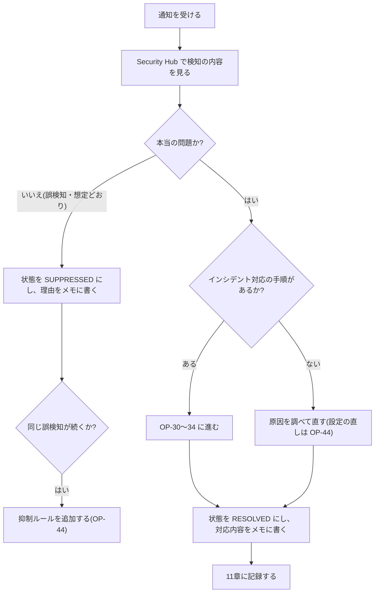

# 運用手順書:架空の小さな会社「ミナト企画」のゼロトラスト環境

| 項目 | 内容 |
|---|---|
| 文書番号 | DOC-04 |
| 版 | 0.1(初版ドラフト) |
| 作成日 | 2026-11-18 |
| 作成者 | (自分の名前) |
| 関連文書 | DOC-01 要件定義書(v0.2)、DOC-02 脅威分析書(v0.1)、DOC-03 方式設計書(v0.1) |
| 状態 | レビュー前 |

### 改版履歴
| 版 | 日付 | 内容 |
|---|---|---|
| 0.1 | 2026-11-18 | 初版 |

> コマンドの `<...>` は、その場の値に置き換えます。手順は構築しながら実際に試し、違っていたら直します。

---

## 1. 目的と前提
- DOC-03 で設計した環境を、**情報システム担当1人が週2時間以内で** 運用するための手順をまとめる(NFR-OPS-01)
- **すべての設定変更は Terraform のコードで行う。** 画面での手作業は、この文書で「手動」と書いたものと、緊急時だけにする
- 手順を実行したら、11章の記録を残す

---

## 2. 運用体制

### 2.1 役割
| 役割 | 担当 | 主な仕事 |
|---|---|---|
| 運用担当(一次対応) | 情報システム担当 | アラートの対応、アカウント管理、変更の実施、月次の振り返りの準備 |
| 責任者(エスカレーション先) | 代表 | 期限を過ぎたアラートの判断、重大な事故の対外対応、月次の振り返りでの意思決定 |
| 代わりの担当 | (開発の1名を指名) | 情報システム担当が不在のときの Critical の一次対応(読み取りと通知まで) |

### 2.2 連絡の経路
| 状況 | 経路 |
|---|---|
| 通常の通知 | Slack の `#security-alerts` |
| エスカレーション | Slack の `#security-alerts` + 代表へのメール |
| Slack が使えないとき | メール、電話 |

---

## 3. 定常運用

| 頻度 | 目安の時間 | 作業 | 手順 |
|---|---|---|---|
| 毎日(営業日) | 5分 | Slack の `#security-alerts` を見て、新しい通知があれば対応する | OP-20 |
| 毎週 | 30分 | 「対応状況」のダッシュボードを見て、期限が近いアラートを片づける。費用を確認する | OP-20, OP-40 |
| 毎月 | 60分 | 月次の振り返り(代表と一緒に行う) | OP-50 |
| 3か月ごと | 30分 | 権限の棚卸しと、文書の見直し | OP-51 |

**1か月の合計:** 約5分×20日+30分×4週+60分 = 約4.7時間(週あたり約1.2時間)で、目標の週2時間以内に収まる。

---

## 4. 手順の一覧

| 分類 | ID | 手順 |
|---|---|---|
| アカウント管理 | OP-10 | 入社したとき |
| | OP-11 | 退職したとき |
| | OP-12 | 外部委託者を受け入れる・終えるとき |
| | OP-13 | 権限を変えるとき |
| アラート対応 | OP-20 | アラート対応の共通手順 |
| | OP-21 | 自動対応を取り消す・例外にするとき |
| インシデント対応 | OP-30 | アクセスキーが漏れたとき |
| | OP-31 | EC2 が不審な通信をしているとき |
| | OP-32 | 秘密情報を GitHub にコミットしてしまったとき |
| | OP-33 | 緊急用アカウント(ルートユーザー)を使うとき |
| | OP-34 | IdP・ZTNA が使えないとき |
| 費用・環境 | OP-40 | 費用アラートが来たとき |
| | OP-41 | 無料トライアルが終わるとき |
| | OP-42 | 環境を起動・停止するとき |
| | OP-43 | 環境をすべて削除するとき |
| 変更・改善 | OP-44 | 設定を変更するとき |
| | OP-50 | 月次の振り返り |
| | OP-51 | 権限の棚卸しと文書の見直し |

---

## 5. アカウント管理

### OP-10 入社したとき
| 項目 | 内容 |
|---|---|
| きっかけ | 代表から入社の連絡(入社日の3営業日前まで) |
| 担当 | 情報システム担当 |
| 要件 | FR-ID-01, 02, 03 |

1. `terraform/identity/users.tf`(または変数ファイル)に利用者を追加し、所属グループ(DOC-03 5.1)を書く
2. プルリクエストを作り、`terraform plan` の結果で「ユーザー1人とグループの所属だけが増える」ことを確かめる
3. マージした後、自分の PC から `terraform apply` する(OP-44)
4. Identity Center から届く招待メールで、本人にパスワードを設定してもらう
5. 本人と一緒に、パスキー(FIDO2)を登録する
6. 本人が、許可されたアプリだけを開けることを確かめる(許可していないアプリが拒否されることも確かめる)

**確認:** ダッシュボードの「サインインの失敗数」に異常がないこと

### OP-11 退職したとき
| 項目 | 内容 |
|---|---|
| きっかけ | 代表から退職の連絡 |
| 担当 | 情報システム担当 |
| 期限 | 最終出社日の終業時刻 |
| 要件 | FR-ID-07、TH-04 |

1. **すぐに止める(手動):** Identity Center の画面で、そのユーザーの「ユーザーアクセスを無効にする」を実行する
2. **今あるセッションを切る(手動):** Cloudflare Zero Trust の画面で、そのユーザーのセッションを取り消す
3. **コードに反映する:** `users.tf` からユーザーを消すプルリクエストを作り、適用する(OP-44)
4. そのユーザーが作ったリソースや、共有していた情報がないか確かめる

**確認**
- そのユーザーで AWS とアプリにサインインできないこと(テストできない場合は、Identity Center の状態が「無効」であることを見る)
- AWS コンソールのセッションは最大1時間(DOC-03 5.1)で切れるため、その間の操作を CloudTrail で確かめる

> 1と2を先に行うのは、コードの変更を待つ間に入られないようにするためです。

### OP-12 外部委託者を受け入れる・終えるとき
| 項目 | 内容 |
|---|---|
| きっかけ | 業務委託の契約 |
| 担当 | 情報システム担当 |
| 要件 | FR-ID-06、FR-AC-03、TH-10 |

**受け入れ**
1. OP-10 と同じ手順で追加する。グループは `g-contractor` だけにする
2. SSM Parameter Store の期限の一覧に、ユーザー名と契約の終了日を登録する
3. 検証アプリは開けて、本番のアプリ(顧客管理・経理・Wiki)は拒否されることを確かめる

**終了**
- 期限の日に、Lambda が自動で `g-contractor` から外し、Slack に通知する
- 通知が来たら、OP-11 の3〜4を行う
- 契約を早く終えるときは、OP-11 をそのまま行う

### OP-13 権限を変えるとき
1. 依頼を受けたら、依頼した人・理由・期間を記録する
2. グループの所属を変えるプルリクエストを作る。**管理者の権限(`g-it-admin`)を足す変更は、代表の承認を得る**
3. 適用し、本人が新しい権限を使えることを確かめる
4. 期間限定の場合は、終了日を11章の記録に書き、その日に元に戻す

---

## 6. アラート対応

### OP-20 アラート対応の共通手順
| 項目 | 内容 |
|---|---|
| きっかけ | Slack への通知、ダッシュボード、エスカレーション |
| 担当 | 情報システム担当(期限を過ぎたら代表) |
| 要件 | FR-RS-01、FR-DB-02, 03、NFR-OPS-02 |

**対応期限(DOC-01 NFR-OPS-02)**
| 重大度 | 初動の期限 | 期限を過ぎたら |
|---|---|---|
| Critical | 4時間 | 代表にエスカレーション |
| High | 24時間 | 代表にエスカレーション |
| Medium | 3営業日 | 情報システム担当に再通知 |
| Low | 月次の振り返り | ― |

**流れ**


**1. 内容を見る**
- Slack の通知にあるリンクから、Security Hub の検知を開く
- 見ること:どのアカウントの、どのリソースか/いつ起きたか/誰(どのロール)の操作か/自動対応は動いたか

**2. 対応を始めたことを示す**
- 状態は、通知のときに Lambda が NOTIFIED にしている。対応を始めたら、メモに「対応中:<担当者名>」と書く

**3. 終わったら状態を変える**
```bash
aws securityhub batch-update-findings \
  --finding-identifiers Id=<検知のID>,ProductArn=<製品のARN> \
  --workflow Status=RESOLVED \
  --note Text="<対応内容>",UpdatedBy="<担当者名>"
```
- 問題がなかった場合は `Status=SUPPRESSED` にし、メモに理由を書く
- 状態を変えると、ダッシュボードの「未対応のアラート数」と「対応までの平均時間」に反映される

**調べるときに使う Athena の検索(例)**
```sql
-- ある利用者の直近7日の操作
SELECT eventtime, eventname, recipientaccountid, awsregion, sourceipaddress, errorcode
FROM cloudtrail_logs
WHERE useridentity.arn LIKE '%<ユーザー名>%'
  AND eventtime > to_iso8601(current_timestamp - interval '7' day)
ORDER BY eventtime DESC;

-- 失敗した操作が多い順(権限を探られていないか)
SELECT useridentity.arn, eventname, count(*) AS cnt
FROM cloudtrail_logs
WHERE errorcode IN ('AccessDenied', 'UnauthorizedOperation')
  AND eventtime > to_iso8601(current_timestamp - interval '1' day)
GROUP BY useridentity.arn, eventname
ORDER BY cnt DESC
LIMIT 20;
```
> テーブル名や列名は、Athena のテーブルを作ったときの定義に合わせて直します。

### OP-21 自動対応を取り消す・例外にするとき
| 項目 | 内容 |
|---|---|
| きっかけ | 自動対応(AR-1 など)が、正しく使っているリソースに動いてしまった |
| 要件 | FR-RS-06, 08、TH-26 |

**取り消す(例:AR-1 で消されたセキュリティグループのルール)**
1. Slack の自動対応の通知から、消されたルールの内容(ポート、送信元、セキュリティグループID)を確かめる
2. 本当に全開放が必要かを考える。**多くの場合は、送信元を絞れば足りる**
3. 必要なルールを Terraform のコードに書き、プルリクエストで適用する

**例外にする**
1. 例外の理由と期限を決め、代表の承認を得る
2. リソースに `auto-remediation=false` のタグを Terraform で付ける
3. 例外の一覧は月次の振り返り(OP-50)で見直す

```bash
# 例外になっているリソースの一覧
aws resourcegroupstaggingapi get-resources \
  --tag-filters Key=auto-remediation,Values=false
```

---

## 7. インシデント対応

すべてのインシデントは、次の流れで進めます(NIST SP 800-61 の考え方をもとにしています)。

| 段階 | やること |
|---|---|
| 1. 検知・判断 | 本当のインシデントか、どれくらい大きいかを判断する |
| 2. 封じ込め | 被害が広がらないように止める(キーの無効化、隔離など) |
| 3. 根絶 | 原因を取り除く(漏れた場所を消す、脆弱性を直す) |
| 4. 復旧 | 元の状態に戻し、正常に動くことを確かめる |
| 5. 振り返り | 原因と対策を記録し、要件・設計・手順を直す |

**代表に連絡する基準:** 顧客情報が漏れた可能性があるとき、または封じ込めに4時間以上かかりそうなときは、時間に関係なくすぐに代表に連絡する。

### OP-30 アクセスキーが漏れたとき
| 項目 | 内容 |
|---|---|
| きっかけ | AWS Health の「認証情報が公開された」イベント、GuardDuty の検知、自動対応 AR-4 の通知 |
| 脅威 | TH-14、シナリオ A |

> 方針として長期のアクセスキーは作らない(FR-ID-04)ため、この手順が動くのは、例外で作ったキーか、ルールを破って作られたキーです。

1. **封じ込め:** キーが無効になっているか確かめる(AR-4 が動いていればなっている)。なっていなければ、すぐに無効にする
   ```bash
   aws iam update-access-key --user-name <ユーザー名> --access-key-id <キーID> --status Inactive
   ```
2. **影響を調べる:** Athena で、そのキーを使った操作を調べる(`useridentity.accesskeyid = '<キーID>'`)。特に IAM の作成・変更、EC2 の起動、S3 の読み取りを見る
3. **攻撃者が作ったものを消す:** 2で見つかったリソース(IAM ユーザー、キー、EC2 など)を消す。SCP で禁止しているはずなので、作られていたら SCP の抜けも調べる
4. **根絶:** キーが漏れた場所(GitHub など)から消す(OP-32)。キーそのものも削除する
5. **復旧:** そのキーが必要だった処理は、ロールと一時的な認証情報に置き換える
6. **費用を確かめる:** Cost Explorer で、使っていないリージョンやサービスの料金が増えていないか見る
7. **振り返り:** なぜ長期のキーが作られたかを記録し、防ぐ方法を検討する

### OP-31 EC2 が不審な通信をしているとき
| 項目 | 内容 |
|---|---|
| きっかけ | GuardDuty の検知(暗号資産のマイニング、不審な宛先との通信など)、自動対応 AR-5 の通知 |
| 脅威 | TH-11, 13, 17 |

1. **封じ込め:** EC2 が隔離用のセキュリティグループ(通信をすべて止める)に付け替えられているか確かめる。なっていなければ付け替える
2. **証拠を残す:** **EC2 を止める前に**、EBS のスナップショットを取る(調査用。メモリの情報は止めると消える)
3. **影響を調べる:** EC2 のロールの権限で何ができたか、CloudTrail でそのロールの操作を調べる
4. **根絶と復旧:** EC2 を作り直す(Terraform で消して作り直す)。原因(脆弱性、漏れた認証情報)を直してから作る
5. **振り返り:** 調べ終わったスナップショットは消す(費用のため)

### OP-32 秘密情報を GitHub にコミットしてしまったとき
| 項目 | 内容 |
|---|---|
| きっかけ | pre-commit の gitleaks、GitHub の Push Protection、自分で気づいた |
| 脅威 | TH-14, 27, 31 |

**プッシュする前に気づいた(pre-commit や Push Protection で止まった)**
1. ファイルから秘密情報を消し、環境変数や SSM Parameter Store から読むように直す
2. `git commit --amend` などで、コミットから消してからプッシュする

**プッシュした後に気づいた**
1. **最初に、その秘密情報を無効にする**(キーの無効化、Webhook の作り直し、パスワードの変更)。**履歴を消すより先に行う。** 公開された時点で、もう漏れたと考える
2. AWS のキーなら OP-30 に進む
3. リポジトリの履歴から消す(`git filter-repo` など)。ただし、フォークやキャッシュに残る可能性があるため、1の代わりにはならない
4. なぜ pre-commit で止まらなかったかを調べ、ルールを直す

### OP-33 緊急用アカウント(ルートユーザー)を使うとき
| 項目 | 内容 |
|---|---|
| きっかけ | Identity Center が使えず、AWS の操作がどうしても必要 |
| 要件 | FR-ID-08、FR-RS-07 |

1. 代表に、使う理由を伝えて承認を得る
2. 管理アカウントのルートユーザーで、ハードウェアの MFA を使ってサインインする
3. 必要な操作だけを行う
4. サインインすると Slack に通知が来る(AR-2)。その通知に、理由と行った操作を返信で書く
5. 終わったらサインアウトし、11章に記録する

### OP-34 IdP・ZTNA が使えないとき
| 項目 | 内容 |
|---|---|
| きっかけ | 社員から「アプリに入れない」という連絡が複数ある |
| 脅威 | TH-06, 09、残るリスク RR-2 |

1. AWS Health Dashboard と Cloudflare のステータスページで、障害が出ているか確かめる
2. **事業者の障害の場合:** 社員に状況を知らせ、復旧を待つ。急ぎの業務は代表が判断する。**ZTNA を外して社内アプリを直接公開することはしない**
3. **自分の設定の問題の場合:** 直近の変更(Terraform の適用、Cloudflare のポリシー)を確かめ、元に戻す(OP-44)
4. AWS の操作が必要なら、OP-33 に進む

---

## 8. 費用と環境

### OP-40 費用アラートが来たとき
| 項目 | 内容 |
|---|---|
| きっかけ | AWS Budgets(予測3,000円・実績5,000円)、Cost Anomaly Detection の通知 |
| 要件 | NFR-COST-02 |

1. Cost Explorer で、サービス別・アカウント別・リージョン別の料金を見る
2. 次のどれに当たるかを判断する

| 原因 | 対応 |
|---|---|
| 消し忘れ(VPN、NAT インスタンス、スナップショットなど) | OP-42 で止める・消す |
| 無料トライアルが終わった | OP-41 で判断する |
| 東京以外のリージョンや、使っていないサービスの料金 | **不正利用を疑う。** OP-30 に進む |
| 想定どおりの増加 | DOC-03 11章の概算を直し、予算を見直す |

### OP-41 無料トライアルが終わるとき
| 項目 | 内容 |
|---|---|
| きっかけ | 11.2 の一覧で、終わる日の3日前 |
| 要件 | NFR-COST-04 |

1. 各サービスの画面で、トライアル後の月額の見込みを確かめる(GuardDuty と Security Hub は、画面に見込みが表示される)
2. 見込みが DOC-03 11章の概算に収まれば、続ける
3. 収まらない場合は、次の順で減らす:
   - 追加の保護プランや基準を止める
   - Config の記録対象をさらに絞る
   - 検証アカウントだけ止める(本番・管理・ログ・セキュリティは残す)
4. 決めた内容を 11.2 に記録する

### OP-42 環境を起動・停止するとき
**社内アプリの EC2(使うときだけ起動)**
```bash
# 起動
aws ec2 start-instances --instance-ids <インスタンスID> --profile <本番のプロファイル>
# 停止
aws ec2 stop-instances --instance-ids <インスタンスID> --profile <本番のプロファイル>
```
- 停止中は EBS の料金だけがかかる
- 停止すると cloudflared のトンネルも切れるため、アプリには入れなくなる(想定どおり)

**時間で課金されるリソース(使うときだけ作る)**
| リソース | 作る | 消す |
|---|---|---|
| Site-to-Site VPN(P3) | `terraform apply -var="enable_vpn=true"` | `terraform apply -var="enable_vpn=false"` |
| NAT インスタンス(DOC-03 6.3 の代替案) | `terraform apply -var="enable_nat=true"` | `terraform apply -var="enable_nat=false"` |

- 作ったら、11章の記録に「作った日時」を書く。その日のうちに消す
- **消し忘れの確認:** 毎週の作業(3章)で、次のコマンドの結果が空であることを見る
```bash
aws ec2 describe-vpn-connections --filters Name=state,Values=available --profile <本番のプロファイル>
aws ec2 describe-instances --filters Name=instance-state-name,Values=running --profile <本番のプロファイル>
```

### OP-43 環境をすべて削除するとき
ポートフォリオの公開を終えたときや、作り直すときに使います。**依存しているものから逆の順に消します。**

| 順番 | 対象 | 方法 | 注意 |
|---|---|---|---|
| 1 | dashboard、response | `terraform destroy` | |
| 2 | zerotrust、network | `terraform destroy` | Cloudflare のトンネルとアプリも消える |
| 3 | detection | `terraform destroy` | GuardDuty などを止める前に、検知結果の S3 へのエクスポートが終わっているか見る |
| 4 | logging | `terraform destroy` | **オブジェクトロックの保持期間中のログは消せない。** 保持期間が終わるまでバケットは残る(料金は少額) |
| 5 | identity、baseline | `terraform destroy` | Budgets も消えるので、最後まで残したい場合は順番を後にする |
| 6 | org | `terraform destroy` | メンバーアカウントは閉鎖される。閉鎖後90日は復元できる期間がある。一度に閉鎖できる数には上限がある(要確認) |
| 7 | bootstrap | 手動 | 状態ファイルの S3 を空にしてから消す。GitHub の OIDC のロールも消す |
| 8 | 管理アカウント以外 | 手動 | Cloudflare のアカウント、ドメインの自動更新を止める |

**削除の確認**
- Cost Explorer で、翌日以降の料金が0円(ログ用 S3 の少額を除く)になっていること
- `terraform state list` が、すべてのディレクトリで空であること

---

## 9. 変更と改善

### OP-44 設定を変更するとき
| 項目 | 内容 |
|---|---|
| 要件 | NFR-MNT-01, 02、NFR-SEC-06 |

1. ブランチを作り、Terraform のコードを直す
2. コミットすると、pre-commit で gitleaks・`terraform fmt`・tflint が動く。エラーがあれば直す
3. プルリクエストを作ると、GitHub Actions が `terraform plan` と Checkov を実行し、結果をコメントする
4. plan の結果を読む。**特に「destroy(削除)」と「replace(作り直し)」がないか見る。** 意図しないものがあれば止める
5. マージする
6. 自分の PC で SSO にログインし、適用する
   ```bash
   aws sso login --profile <プロファイル>
   cd terraform/<対象のディレクトリ>
   terraform plan    # プルリクエストのときと同じ結果か確かめる
   terraform apply
   ```
7. 変更が効いていることを確かめ、11章に記録する

**戻すとき:** 前のコミットに戻すプルリクエストを作り、同じ手順で適用する

**緊急で画面から直したとき:** 直した後、必ず同じ内容をコードに書く。`terraform plan` で差分がないことを確かめる(コードと実際の環境がずれたままにしない)

### OP-50 月次の振り返り
| 項目 | 内容 |
|---|---|
| 参加者 | 代表、情報システム担当 |
| 時間 | 60分 |
| 要件 | NFR-OPS-04 |

**議題**
| # | 見ること | 使うもの |
|---|---|---|
| 1 | 成功の基準(DOC-01 K-1〜K-6)を満たしているか | 3枚のダッシュボード |
| 2 | 先月のアラートの件数と、対応までの平均時間の推移 | 「対応状況」のダッシュボード |
| 3 | 期限を過ぎたアラートと、その理由 | エスカレーションの記録 |
| 4 | 誤検知と、抑制ルールの追加 | Security Hub の SUPPRESSED の一覧 |
| 5 | 自動対応の例外(`auto-remediation=false`)を続けるか | OP-21 のコマンド |
| 6 | 費用と、トライアルの状況 | Cost Explorer、11.2 |
| 7 | 外部委託者の期限 | SSM Parameter Store の期限の一覧 |
| 8 | 決めたこと(要件・設計・手順の直し) | ― |

**結果:** 議事録を11章の記録に残す。決めたことは、関係する文書を直す

### OP-51 権限の棚卸しと文書の見直し(3か月ごと)
1. `terraform/identity/` のコードを見て、グループの所属が今の役割に合っているか確かめる
2. 各ディレクトリで `terraform plan` を実行し、コードと実際の環境に差分がないことを確かめる(画面から変えられていないか)
3. 90日以上サインインしていない利用者がいないか、CloudTrail で確かめる
4. DOC-01〜04 を読み直し、今の環境と違うところを直す
5. 製品や構成を変えた場合は、DOC-02 の脅威分析を見直す

---

## 10. 初めて構築するときの順番
運用の手順ではありませんが、環境を作り直すときのために残します。

| 順番 | 対象 | 内容 | 手動の作業 |
|---|---|---|---|
| 1 | 準備 | ルートユーザーの MFA、Organizations と Identity Center の最小限の設定 | すべて手動(詳しくは [P0 の構築手順](build/P0_準備.md)) |
| 2 | bootstrap | 状態ファイル用の S3、GitHub OIDC のロール、Budgets と Cost Anomaly Detection | ここだけはローカルの状態ファイルから始め、あとで S3 に移す |
| 3 | org | Organizations、OU、アカウント、SCP | |
| 4 | identity | Identity Center、グループ、許可セット | Identity Center の有効化と MFA の設定(手動の可能性あり) |
| 5 | baseline | 全アカウント共通の予防的な設定 | |
| 6 | logging | 組織の証跡、ログ用 S3 | |
| 7 | detection | GuardDuty、Security Hub、Config、Access Analyzer | トライアルの開始日を 11.2 に記録 |
| 8 | response | EventBridge、Lambda、SNS | Slack の Webhook URL を SSM に登録(手動) |
| 9 | dashboard | ダッシュボード、集計の Lambda | |
| 10 | network、zerotrust | VPC、EC2、Cloudflare | ドメインの登録、Cloudflare の API トークンの作成(手動) |

---

## 11. 記録

記録は、リポジトリの `ops-log/` に Markdown で残します(公開しても問題ない内容だけを書く。アカウントID、IPアドレス、メールアドレスは書かない)。

### 11.1 作業の記録(書き方)
| 日付 | 手順 | 担当 | 内容 | 結果 |
|---|---|---|---|---|
| 2026-xx-xx | OP-10 | 情報システム担当 | 営業 A さんの入社 | 完了 |

### 11.2 無料トライアルと時間課金のリソース
| サービス・リソース | 開始日 | 終わる日 | 判断(続ける/止める) |
|---|---|---|---|
| GuardDuty | | | |
| Security Hub | | | |
| (VPN などを作ったら書く) | | | |

### 11.3 インシデントの記録(書き方)
| 項目 | 内容 |
|---|---|
| 発生日時・検知日時 | |
| きっかけ(どの検知か) | |
| 影響 | |
| 対応(封じ込め・根絶・復旧) | |
| 原因 | |
| 再発防止(直した要件・設計・手順) | |
