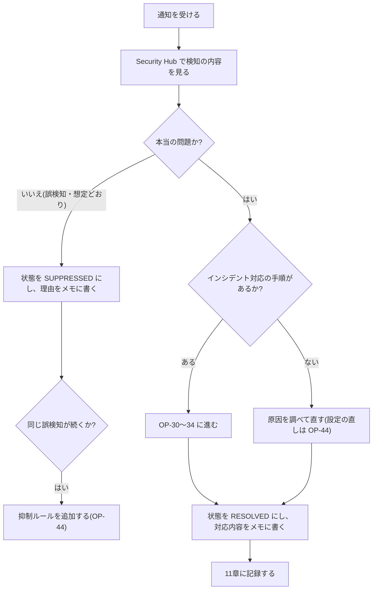

# 運用手順書:架空の小さな会社「ミナト企画」のゼロトラスト環境

| 項目 | 内容 |
|---|---|
| 文書番号 | DOC-04 |
| 版 | 0.1(初版ドラフト) |
| 作成日 | 2026-11-18 |
| 作成者 | (自分の名前) |
| 関連文書 | DOC-01 要件定義書(v0.2)、DOC-02 脅威分析書(v0.1)、DOC-03 方式設計書(v0.1) |
| 状態 | レビュー前 |

### 改版履歴
| 版 | 日付 | 内容 |
|---|---|---|
| 0.1 | 2026-11-18 | 初版 |

> コマンドの `<...>` は、その場の値に置き換えます。手順は構築しながら実際に試し、違っていたら直します。

---

## 1. 目的と前提
- DOC-03 で設計した環境を、**情報システム担当1人が週2時間以内で** 運用するための手順をまとめる(NFR-OPS-01)
- **すべての設定変更は Terraform のコードで行う。** 画面での手作業は、この文書で「手動」と書いたものと、緊急時だけにする
- 手順を実行したら、11章の記録を残す

---

## 2. 運用体制

### 2.1 役割
| 役割 | 担当 | 主な仕事 |
|---|---|---|
| 運用担当(一次対応) | 情報システム担当 | アラートの対応、アカウント管理、変更の実施、月次の振り返りの準備 |
| 責任者(エスカレーション先) | 代表 | 期限を過ぎたアラートの判断、重大な事故の対外対応、月次の振り返りでの意思決定 |
| 代わりの担当 | (開発の1名を指名) | 情報システム担当が不在のときの Critical の一次対応(読み取りと通知まで) |

### 2.2 連絡の経路
| 状況 | 経路 |
|---|---|
| 通常の通知 | Slack の `#security-alerts` |
| エスカレーション | Slack の `#security-alerts` + 代表へのメール |
| Slack が使えないとき | メール、電話 |

---

## 3. 定常運用

| 頻度 | 目安の時間 | 作業 | 手順 |
|---|---|---|---|
| 毎日(営業日) | 5分 | Slack の `#security-alerts` を見て、新しい通知があれば対応する | OP-20 |
| 毎週 | 30分 | 「対応状況」のダッシュボードを見て、期限が近いアラートを片づける。費用を確認する | OP-20, OP-40 |
| 毎月 | 60分 | 月次の振り返り(代表と一緒に行う) | OP-50 |
| 3か月ごと | 30分 | 権限の棚卸しと、文書の見直し | OP-51 |

**1か月の合計:** 約5分×20日+30分×4週+60分 = 約4.7時間(週あたり約1.2時間)で、目標の週2時間以内に収まる。

---

## 4. 手順の一覧

| 分類 | ID | 手順 |
|---|---|---|
| アカウント管理 | OP-10 | 入社したとき |
| | OP-11 | 退職したとき |
| | OP-12 | 外部委託者を受け入れる・終えるとき |
| | OP-13 | 権限を変えるとき |
| アラート対応 | OP-20 | アラート対応の共通手順 |
| | OP-21 | 自動対応を取り消す・例外にするとき |
| インシデント対応 | OP-30 | アクセスキーが漏れたとき |
| | OP-31 | EC2 が不審な通信をしているとき |
| | OP-32 | 秘密情報を GitHub にコミットしてしまったとき |
| | OP-33 | 緊急用アカウント(ルートユーザー)を使うとき |
| | OP-34 | IdP・ZTNA が使えないとき |
| 費用・環境 | OP-40 | 費用アラートが来たとき |
| | OP-41 | 無料トライアルが終わるとき |
| | OP-42 | 環境を起動・停止するとき |
| | OP-43 | 環境をすべて削除するとき |
| 変更・改善 | OP-44 | 設定を変更するとき |
| | OP-45 | SAML のアプリを作り直す・証明書を更新するとき |
| | OP-46 | Terraform で管理できない設定を確かめるとき |
| | OP-47 | Cloudflare のトークンを更新するとき |
| | OP-50 | 月次の振り返り |
| | OP-51 | 権限の棚卸しと文書の見直し |

---

## 5. アカウント管理

### OP-10 入社したとき
| 項目 | 内容 |
|---|---|
| きっかけ | 代表から入社の連絡(入社日の3営業日前まで) |
| 担当 | 情報システム担当 |
| 要件 | FR-ID-01, 02, 03 |

1. `terraform/identity/main.tf` の利用者の一覧(`aws_identitystore_user` と `aws_identitystore_group_membership` の元になる `locals`)に利用者を追加し、所属グループ(DOC-03 5.1)を書く。メールアドレスなど公開しない値は `terraform.tfvars` と GitHub の Secret で渡す
2. プルリクエストを作り、`terraform plan` の結果で「ユーザー1人とグループの所属だけが増える」ことを確かめる
3. マージした後、自分の PC から `terraform apply` する(OP-44)
4. 本人にパスワードを設定してもらう。**Terraform(API)で作った利用者には、招待メールが自動では届かず、パスワードもない**(AWS の公式ドキュメント「Email one-time password to users created with API or CLI」)。次のどちらかで最初のサインインをしてもらう
   - 方法 A(おすすめ):Identity Center の画面 → 設定 → 認証 → 標準認証の「設定」で「**Send email OTP**」を有効にしておく。本人がアクセスポータルで最初にサインインしようとすると、確認のメールが届き、パスワードを設定できる
   - 方法 B:Identity Center の画面 → ユーザー → その利用者 → 「**パスワードをリセット**」→「ワンタイムパスワードを生成してユーザーと共有する」を選び、本人に渡す(「手順をメールで送る」も選べる。その場合は、送る前にメールアドレスが正しいことを確かめる)
5. 本人と一緒に、パスキー(FIDO2)を登録する
6. 本人が、許可されたアプリだけを開けることを確かめる(許可していないアプリが拒否されることも確かめる)

**確認:** ダッシュボードの「サインインの失敗数」に異常がないこと

### OP-11 退職したとき
| 項目 | 内容 |
|---|---|
| きっかけ | 代表から退職の連絡 |
| 担当 | 情報システム担当 |
| 期限 | 最終出社日の終業時刻 |
| 要件 | FR-ID-07、TH-04 |

1. **すぐに止める(手動):** Identity Center の画面で、そのユーザーの「ユーザーアクセスを無効にする」を実行する
2. **今あるセッションを切る(手動):** Cloudflare Zero Trust の画面で、そのユーザーのセッションを取り消す
3. **コードに反映する:** `terraform/identity/main.tf` の利用者の一覧からユーザーを消すプルリクエストを作り、適用する(OP-44)
4. そのユーザーが作ったリソースや、共有していた情報がないか確かめる

**確認**
- そのユーザーで AWS とアプリにサインインできないこと(テストできない場合は、Identity Center の状態が「無効」であることを見る)
- AWS コンソールのセッションは最大1時間(DOC-03 5.1)で切れるため、その間の操作を CloudTrail で確かめる

> 1と2を先に行うのは、コードの変更を待つ間に入られないようにするためです。

### OP-12 外部委託者を受け入れる・終えるとき
| 項目 | 内容 |
|---|---|
| きっかけ | 業務委託の契約 |
| 担当 | 情報システム担当 |
| 要件 | FR-ID-06、FR-AC-03、TH-10 |

**受け入れ**
1. OP-10 と同じ手順で追加する。グループは `g-contractor` だけにする
2. `terraform/identity` の利用者の一覧に、契約の終了日を `expires = "YYYY-MM-DD"` で書く(その日の 0 時から使えなくなる)。PR → apply
3. 検証アプリは開けて、本番のアプリ(顧客管理・経理・Wiki)は拒否されることを確かめる

**終了**
- 終了日の 0:10 に、Lambda(管理アカウント `zero-trust-minato-contractor-expiry`)が自動で `g-contractor` から外し、メールで知らせる(「外部委託者の期限切れ」)
- 通知が来たら:
  1. Cloudflare Zero Trust の画面で、その人のセッションを取り消す(OP-11 の手順2。アプリのセッションは最大8時間残るため)
  2. OP-11 の手順3〜4(コードの一覧からその人を消す PR。`expires` の行ごと消す)
- 契約を早く終えるときは、OP-11 をそのまま行う
- Lambda が失敗すると、アラームの通知が来る。そのときは手で OP-11 を行う
- 終了日に通知が来ないときも、手で OP-11 を行う(止まったことを知らせるアラームはない。終了日は前から分かっているので、通知が来ないことで気づく。OP-20 の「Lambda の失敗・停止のアラーム」)

### OP-13 権限を変えるとき
1. 依頼を受けたら、依頼した人・理由・期間を記録する
2. グループの所属を変えるプルリクエストを作る。**管理者の権限(`g-it-admin`)を足す変更は、代表の承認を得る**
3. 適用し、本人が新しい権限を使えることを確かめる
4. 期間限定の場合は、終了日を11章の記録に書き、その日に元に戻す

---

## 6. アラート対応

### OP-20 アラート対応の共通手順
| 項目 | 内容 |
|---|---|
| きっかけ | Slack への通知、ダッシュボード、エスカレーション |
| 担当 | 情報システム担当(期限を過ぎたら代表) |
| 要件 | FR-RS-01、FR-DB-02, 03、NFR-OPS-02 |

**対応期限(DOC-01 NFR-OPS-02)**
| 重大度 | 初動の期限 | 期限を過ぎたら |
|---|---|---|
| Critical | 4時間 | 代表にエスカレーション |
| High | 24時間 | 代表にエスカレーション |
| Medium | 3営業日 | 情報システム担当に再通知 |
| Low | 月次の振り返り | ― |

**流れ**


**1. 内容を見る**
- Slack の通知にあるリンクから、Security Hub の検知を開く
- 見ること:どのアカウントの、どのリソースか/いつ起きたか/誰(どのロール)の操作か/自動対応は動いたか

**2. 対応を始めたことを示す**
- 状態は、通知のときに Lambda が NOTIFIED にしている。対応を始めたら、担当者を `UserDefinedFields` の `assignee` に書き、メモに「対応中」と書く(FR-DB-02)。**assignee を書くと、エスカレーションの対象から外れる**(初動済みとみなす。DOC-03 8.4)
- `UserDefinedFields` を更新したときに、ほかのキー(エスカレーションの `escalatedAt`)が残るのか消えるのかは、公式の API リファレンスに書かれていない(**要確認**)。消えないように、**今の値を見てから、`escalatedAt` があればそれも一緒に書く**
```bash
# 今の UserDefinedFields を見る
aws securityhub get-findings --filters '{"Id":[{"Value":"<検知のID>","Comparison":"EQUALS"}]}' \
  --query 'Findings[0].UserDefinedFields'
# assignee を書く(escalatedAt があれば、同じ値を一緒に書く)
aws securityhub batch-update-findings \
  --finding-identifiers Id=<検知のID>,ProductArn=<製品のARN> \
  --user-defined-fields assignee=<担当者名>,escalatedAt=<今の値> \
  --note Text="対応中",UpdatedBy="<担当者名>"
```
- **期限を過ぎると自動でエスカレーションされる**(DOC-03 8.4):CRITICAL は4時間・HIGH は24時間で代表に、MEDIUM は3営業日で情報システム担当に再通知。送った検知には `escalatedAt` が付く。代表に届いたら、代表は情報システム担当に状況を確かめる
- ダッシュボード「対応状況」の⑧(期限切れ)が0でなければ、期限を過ぎたアラートが残っている

**3. 終わったら状態を変える**
```bash
aws securityhub batch-update-findings \
  --finding-identifiers Id=<検知のID>,ProductArn=<製品のARN> \
  --workflow Status=RESOLVED \
  --note Text="<対応内容>",UpdatedBy="<担当者名>"
```
- 問題がなかった場合は `Status=SUPPRESSED` にし、メモに理由を書く
- **RESOLVED にするときは、必ずメモを書く。** ダッシュボードの⑩(対応までの平均時間)は、このメモの時刻を対応の終わりとして使う(人の更新では `UpdatedAt` が変わらないため)
- 状態を変えると、ダッシュボードの「未対応のアラート数」と「対応までの平均時間」に反映される

**調べるときに使う Athena の検索(例。保存した検索は OP-50 の表。下は古い例で、テーブル名は `zero_trust_minato_logs.cloudtrail`、日付の列は `dt`)**
```sql
-- ある利用者の直近7日の操作
SELECT eventtime, eventname, recipientaccountid, awsregion, sourceipaddress, errorcode
FROM cloudtrail_logs
WHERE useridentity.arn LIKE '%<ユーザー名>%'
  AND eventtime > to_iso8601(current_timestamp - interval '7' day)
ORDER BY eventtime DESC;

-- 失敗した操作が多い順(権限を探られていないか)
SELECT useridentity.arn, eventname, count(*) AS cnt
FROM cloudtrail_logs
WHERE errorcode IN ('AccessDenied', 'UnauthorizedOperation')
  AND eventtime > to_iso8601(current_timestamp - interval '1' day)
GROUP BY useridentity.arn, eventname
ORDER BY cnt DESC
LIMIT 20;
```
> テーブル名や列名は、Athena のテーブルを作ったときの定義に合わせて直します。

**Lambda の失敗・停止のアラーム**

通知の件名がアラームの名前(`zero-trust-minato-<関数>-errors` は失敗、`-not-running` は決まった時間に1回も動いていない)のときの手順です。

| 関数(`zero-trust-minato-` の後) | アカウント | 動く間隔 | アラーム | 止まると困ること |
|---|---|---|---|---|
| `metrics` | security | 1時間ごと(`hourly`)、6時間ごと(`athena`) | 失敗、停止(3時間) | ダッシュボードの値が古いまま |
| `escalate` | security | 1時間ごと | 失敗、停止(3時間) | 期限を過ぎたアラートが代表に届かない |
| `contractor-expiry` | 管理 | 毎日 0:10 | 失敗だけ(停止は、終了日に通知が来ないことで気づく。OP-12) | 期限の来た外部委託者がグループに残る |
| `cloudflare-logs`(収集) | log-archive | 6時間ごと | 失敗、停止(8時間) | Cloudflare のログが取れない(Cloudflare 側の保持は24時間) |
| `guardduty-findings`(収集) | log-archive | 検知があったとき | 失敗だけ | GuardDuty の検知が S3 に残らない |

1. **ロググループを見る**:そのアカウントの CloudWatch Logs の `/aws/lambda/zero-trust-minato-<関数>` で、エラーの行(`ERROR`、`Task timed out`、`AccessDenied` など)を探す
```bash
aws logs filter-log-events --profile <そのアカウントのプロファイル> \
  --log-group-name /aws/lambda/zero-trust-minato-<関数> \
  --start-time $(( ($(date +%s) - 6*3600) * 1000 )) --filter-pattern '?ERROR ?"Task timed out" ?AccessDenied'
```
2. **停止のときは**、EventBridge のスケジュールのルールが有効か、Lambda が消えていないかを見る(`terraform plan` で差分が出ないかも見る)
3. **原因を直したら、手で1回動かす**。metrics は `group` を指定する(`{"group":"hourly"}` と `{"group":"athena"}` の2回)。guardduty-findings は検知のイベントで動くので、手では動かさない(次の検知で確かめる)
```bash
aws lambda invoke --profile <そのアカウントのプロファイル> --function-name zero-trust-minato-<関数> \
  --cli-binary-format raw-in-base64-out --payload '<入力。metrics は {"group":"hourly"} など、escalate・contractor-expiry・cloudflare-logs は {}>' out.json
```
4. **escalate が止まっている間は**、期限を過ぎたアラートが自動で代表に届かない。直るまで、情報システム担当が毎日 Security Hub を手で見て、上の対応期限を過ぎた検知(`assignee` がないもの)を代表に知らせる
5. **contractor-expiry が失敗したら**、OP-12 の終了の手順(手で OP-11)を行う
6. 11章に記録する

### OP-21 自動対応を取り消す・例外にするとき
| 項目 | 内容 |
|---|---|
| きっかけ | 自動対応(AR-1 など)が、正しく使っているリソースに動いてしまった |
| 要件 | FR-RS-06, 08、TH-26 |

**取り消す(例:AR-1 で消されたセキュリティグループのルール)**
1. Slack の自動対応の通知から、消されたルールの内容(ポート、送信元、セキュリティグループID)を確かめる
2. 本当に全開放が必要かを考える。**多くの場合は、送信元を絞れば足りる**
3. 必要なルールを Terraform のコードに書き、プルリクエストで適用する

**例外にする**
1. 例外の理由と期限を決め、代表の承認を得る
2. リソースに `auto-remediation=false` のタグを Terraform で付ける
3. 例外の一覧は月次の振り返り(OP-50)で見直す

```bash
# 例外になっているリソースの一覧
aws resourcegroupstaggingapi get-resources \
  --tag-filters Key=auto-remediation,Values=false
```

---

## 7. インシデント対応

すべてのインシデントは、次の流れで進めます(NIST SP 800-61 の考え方をもとにしています)。

| 段階 | やること |
|---|---|
| 1. 検知・判断 | 本当のインシデントか、どれくらい大きいかを判断する |
| 2. 封じ込め | 被害が広がらないように止める(キーの無効化、隔離など) |
| 3. 根絶 | 原因を取り除く(漏れた場所を消す、脆弱性を直す) |
| 4. 復旧 | 元の状態に戻し、正常に動くことを確かめる |
| 5. 振り返り | 原因と対策を記録し、要件・設計・手順を直す |

**代表に連絡する基準:** 顧客情報が漏れた可能性があるとき、または封じ込めに4時間以上かかりそうなときは、時間に関係なくすぐに代表に連絡する。

### OP-30 アクセスキーが漏れたとき
| 項目 | 内容 |
|---|---|
| きっかけ | AWS Health の「認証情報が公開された」イベント、GuardDuty の検知、自動対応 AR-4 の通知 |
| 脅威 | TH-14、シナリオ A |

> 方針として長期のアクセスキーは作らない(FR-ID-04)ため、この手順が動くのは、例外で作ったキーか、ルールを破って作られたキーです。

1. **封じ込め:** キーが無効になっているか確かめる(AR-4 が動いていればなっている)。なっていなければ、すぐに無効にする
   ```bash
   aws iam update-access-key --user-name <ユーザー名> --access-key-id <キーID> --status Inactive
   ```
2. **影響を調べる:** Athena で、そのキーを使った操作を調べる(`useridentity.accesskeyid = '<キーID>'`)。特に IAM の作成・変更、EC2 の起動、S3 の読み取りを見る
3. **攻撃者が作ったものを消す:** 2で見つかったリソース(IAM ユーザー、キー、EC2 など)を消す。SCP で禁止しているはずなので、作られていたら SCP の抜けも調べる
4. **根絶:** キーが漏れた場所(GitHub など)から消す(OP-32)。キーそのものも削除する
5. **復旧:** そのキーが必要だった処理は、ロールと一時的な認証情報に置き換える
6. **費用を確かめる:** Cost Explorer で、使っていないリージョンやサービスの料金が増えていないか見る
7. **振り返り:** なぜ長期のキーが作られたかを記録し、防ぐ方法を検討する

### OP-31 EC2 が不審な通信をしているとき
| 項目 | 内容 |
|---|---|
| きっかけ | GuardDuty の検知(暗号資産のマイニング、不審な宛先との通信など)、自動対応 AR-5 の通知 |
| 脅威 | TH-11, 13, 17 |

1. **封じ込め:** EC2 が隔離用のセキュリティグループ(通信をすべて止める)に付け替えられているか確かめる。なっていなければ付け替える
2. **証拠を残す:** **EC2 を止める前に**、EBS のスナップショットを取る(調査用。メモリの情報は止めると消える)
3. **影響を調べる:** EC2 のロールの権限で何ができたか、CloudTrail でそのロールの操作を調べる
4. **根絶と復旧:** EC2 を作り直す(Terraform で消して作り直す)。原因(脆弱性、漏れた認証情報)を直してから作る
5. **振り返り:** 調べ終わったスナップショットは消す(費用のため)

### OP-32 秘密情報を GitHub にコミットしてしまったとき
| 項目 | 内容 |
|---|---|
| きっかけ | pre-commit の gitleaks、GitHub の Push Protection、自分で気づいた |
| 脅威 | TH-14, 27, 31 |

**プッシュする前に気づいた(pre-commit や Push Protection で止まった)**
1. ファイルから秘密情報を消し、環境変数や SSM Parameter Store から読むように直す
2. `git commit --amend` などで、コミットから消してからプッシュする

**プッシュした後に気づいた**
1. **最初に、その秘密情報を無効にする**(キーの無効化、Webhook の作り直し、パスワードの変更)。**履歴を消すより先に行う。** 公開された時点で、もう漏れたと考える
2. AWS のキーなら OP-30 に進む
3. リポジトリの履歴から消す(`git filter-repo` など)。ただし、フォークやキャッシュに残る可能性があるため、1の代わりにはならない
4. なぜ pre-commit で止まらなかったかを調べ、ルールを直す

### OP-33 緊急用アカウント(ルートユーザー)を使うとき
| 項目 | 内容 |
|---|---|
| きっかけ | Identity Center が使えず、AWS の操作がどうしても必要 |
| 要件 | FR-ID-08、FR-RS-07 |

1. 代表に、使う理由を伝えて承認を得る
2. 管理アカウントのルートユーザーで、ハードウェアの MFA を使ってサインインする
3. 必要な操作だけを行う
4. サインインすると Slack に通知が来る(AR-2)。その通知に、理由と行った操作を返信で書く
5. 終わったらサインアウトし、11章に記録する

### OP-34 IdP・ZTNA が使えないとき
| 項目 | 内容 |
|---|---|
| きっかけ | 社員から「アプリに入れない」という連絡が複数ある |
| 脅威 | TH-06, 09、残るリスク RR-2 |

1. AWS Health Dashboard と Cloudflare のステータスページで、障害が出ているか確かめる
2. **事業者の障害の場合:** 社員に状況を知らせ、復旧を待つ。急ぎの業務は代表が判断する。**ZTNA を外して社内アプリを直接公開することはしない**
3. **自分の設定の問題の場合:** 直近の変更(Terraform の適用、Cloudflare のポリシー)を確かめ、元に戻す(OP-44)
4. AWS の操作が必要なら、OP-33 に進む

---

## 8. 費用と環境

### OP-40 費用アラートが来たとき
| 項目 | 内容 |
|---|---|
| きっかけ | AWS Budgets(予測3,000円・実績5,000円)、Cost Anomaly Detection の通知 |
| 要件 | NFR-COST-02 |

1. Cost Explorer で、サービス別・アカウント別・リージョン別の料金を見る
2. 次のどれに当たるかを判断する

| 原因 | 対応 |
|---|---|
| 消し忘れ(VPN、NAT インスタンス、スナップショットなど) | OP-42 で止める・消す |
| 無料トライアルが終わった | OP-41 で判断する |
| 東京以外のリージョンや、使っていないサービスの料金 | **不正利用を疑う。** OP-30 に進む |
| 想定どおりの増加 | DOC-03 11章の概算を直し、予算を見直す |

### OP-41 無料トライアルが終わるとき
| 項目 | 内容 |
|---|---|
| きっかけ | 11.2 の一覧で、終わる日の3日前 |
| 要件 | NFR-COST-04 |

1. 各サービスの画面で、トライアル後の月額の見込みを確かめる(GuardDuty と Security Hub は、画面に見込みが表示される)
2. 見込みが DOC-03 11章の概算に収まれば、続ける
3. 収まらない場合は、次の順で減らす:
   - 追加の保護プランや基準を止める
   - Config の記録対象をさらに絞る
   - 検証アカウントだけ止める(本番・管理・ログ・セキュリティは残す)
4. 決めた内容を 11.2 に記録する

### OP-42 環境を起動・停止するとき
**社内アプリの EC2(使うときだけ起動)**
```bash
# 起動
aws ec2 start-instances --instance-ids <インスタンスID> --profile <本番のプロファイル>
# 停止
aws ec2 stop-instances --instance-ids <インスタンスID> --profile <本番のプロファイル>
```
- 停止中は EBS の料金だけがかかる
- 停止すると cloudflared のトンネルも切れるため、アプリには入れなくなる(想定どおり)

**時間で課金されるリソース(使うときだけ作る)**
| リソース | 作る | 消す |
|---|---|---|
| Site-to-Site VPN(P3) | `terraform apply -var="enable_vpn=true"` | `terraform apply -var="enable_vpn=false"` |
| NAT インスタンス(DOC-03 6.3 の代替案) | `terraform apply -var="enable_nat=true"` | `terraform apply -var="enable_nat=false"` |

- 作ったら、11章の記録に「作った日時」を書く。その日のうちに消す
- **消し忘れの確認:** 毎週の作業(3章)で、次のコマンドの結果が空であることを見る
```bash
aws ec2 describe-vpn-connections --filters Name=state,Values=available --profile <本番のプロファイル>
aws ec2 describe-instances --filters Name=instance-state-name,Values=running --profile <本番のプロファイル>
```

### OP-43 環境をすべて削除するとき
ポートフォリオの公開を終えたときや、作り直すときに使います。**依存しているものから逆の順に消します。**

| 順番 | 対象 | 方法 | 注意 |
|---|---|---|---|
| 1 | dashboard、response | `terraform destroy` | |
| 2 | ztna | `terraform destroy` | Cloudflare のトンネルとアプリ、VPC とサーバーも消える。**Cloudflare の組織(`cloudflare_zero_trust_organization`)は Zero Trust の土台なので消さない。** ztna を destroy する前に、state から外す(`removed` ブロックを足して apply するか、`terraform state rm cloudflare_zero_trust_organization.this`)。**Identity Center の SAML のアプリは Terraform の外(画面で作ったもの)なので、OP-45 の「アプリを消す」で手で消す** |
| 3 | detection | `terraform destroy` | GuardDuty などを止める前に、検知結果の S3 へのエクスポートが終わっているか見る |
| 4 | logging | `terraform destroy` | **オブジェクトロックの保持期間中のログは消せない。** 保持期間が終わるまでバケットは残る(料金は少額) |
| 5 | identity、baseline | `terraform destroy` | Budgets も消えるので、最後まで残したい場合は順番を後にする |
| 6 | org | `terraform destroy` | メンバーアカウントは閉鎖される。閉鎖後90日は復元できる期間がある。一度に閉鎖できる数には上限がある(要確認) |
| 7 | bootstrap | 手動 | 状態ファイルの S3 を空にしてから消す。GitHub の OIDC のロールも消す |
| 8 | 管理アカウント以外 | 手動 | Cloudflare のアカウント、ドメインの自動更新を止める |

**削除の確認**
- Cost Explorer で、翌日以降の料金が0円(ログ用 S3 の少額を除く)になっていること
- `terraform state list` が、すべてのディレクトリで空であること

---

## 9. 変更と改善

### OP-44 設定を変更するとき
| 項目 | 内容 |
|---|---|
| 要件 | NFR-MNT-01, 02、NFR-SEC-06 |

1. ブランチを作り、Terraform のコードを直す
2. コミットすると、pre-commit で gitleaks・`terraform fmt`・tflint が動く。エラーがあれば直す
3. プルリクエストを作ると、GitHub Actions が `terraform plan` と Checkov を実行し、結果をコメントする
4. plan の結果を読む。**特に「destroy(削除)」と「replace(作り直し)」がないか見る。** 意図しないものがあれば止める
5. マージする
6. 自分の PC で SSO にログインし、適用する
   ```bash
   aws sso login --profile <プロファイル>
   cd terraform/<対象のディレクトリ>
   terraform plan    # プルリクエストのときと同じ結果か確かめる
   terraform apply
   ```
7. 変更が効いていることを確かめ、11章に記録する

**ポリシーを差し替えて古いものを消すとき:** アプリの付け替えと古いポリシーの削除を、別の apply に分ける。1回でまとめると、古いポリシーの削除が先に走り、Cloudflare が 409(まだアプリが使っている)で断ることがある。先に `-target` でアプリだけを適用し、次にふつうの plan で削除だけを適用する(手順は `docs/build/P2_完成形.md` の P2-2b の注意)

**戻すとき:** 前のコミットに戻すプルリクエストを作り、同じ手順で適用する

**緊急で画面から直したとき:** 直した後、必ず同じ内容をコードに書く。`terraform plan` で差分がないことを確かめる(コードと実際の環境がずれたままにしない)

### OP-45 SAML のアプリを作り直す・証明書を更新するとき
| 項目 | 内容 |
|---|---|
| きっかけ | Identity Center のアプリの証明書の期限が近い(画面の「有効期限」が黄色=90日以内)、アプリを作り直す・消すとき |
| 担当 | 情報システム担当 |
| 要件 | FR-AC-01、NFR-MNT-01 |

Identity Center のアプリ(Cloudflare Access 用の SAML 2.0)は API で作れないため、画面で作っている。Terraform が持つのは、そのアプリの ARN と、メタデータの値(サインイン URL・発行者 URL・証明書)だけ。値は `terraform/ztna/terraform.tfvars` と GitHub の Secret(`SSO_APPLICATION_ARN`、`SAML_SSO_URL`、`SAML_ISSUER_URL`、`SAML_CERTIFICATE`)にある。

**証明書を更新する**(AWS の公式ドキュメント「Rotate an IAM Identity Center certificate」の順番。証明書の既定の有効期間は5年)
1. Identity Center の画面 → アプリケーション → そのアプリ →「設定」タブ →「IAM Identity Center メタデータ」の「証明書を管理」→「新しい証明書を生成」(アルゴリズムは SHA-256、鍵は 2048 ビット)
2. 新しい証明書(BEGIN/END の行を除いた Base64)を、`terraform.tfvars` の `saml_certificate` と GitHub の Secret `SAML_CERTIFICATE` に入れる
3. OP-44 の手順で `terraform/ztna` を plan・apply する。plan で変わるのが IdP(`cloudflare_zero_trust_access_identity_provider`)の証明書だけであることを確かめる
4. すぐに、Identity Center の画面で新しい証明書を選び、「アクション」→「アクティブとして設定」
5. 検証用の利用者で、アプリにサインインできることを確かめる
6. 古い証明書を削除する

> 3〜4の間は、Cloudflare(新しい証明書)と Identity Center(古い証明書で署名)が合わず、サインインできない。人の少ない時間に行い、3と4を続けて行う。

**アプリを作り直す**
1. `docs/build/P2_完成形.md` の P2-2b の手順1〜4で、新しいアプリを画面で作る。**属性マッピングの Subject の形式は `unspecified` にする。** emailAddress や persistent にすると、Cloudflare の依頼(NameID の形式に unspecified を求める)を Identity Center が断り、Cloudflare の IdP のテストで「No access」になる
2. 新しい ARN とメタデータの値を、`terraform.tfvars` と GitHub の Secret に入れる
3. OP-44 の手順で `terraform/ztna` を plan・apply する。アプリへのグループの割り当て(`aws_ssoadmin_application_assignment`)が作り直され、IdP の値が変わることを確かめる
4. 検証用の利用者でサインインを確かめてから、古いアプリを消す(下の手順)

**アプリを消す**
1. 先に、Terraform の側を片づける。`terraform/ztna` を destroy するか(**Cloudflare の組織(`cloudflare_zero_trust_organization`)は Zero Trust の土台なので消さない。** ztna を destroy する前に、state から外す(`removed` ブロックを足して apply するか、`terraform state rm cloudflare_zero_trust_organization.this`))、アプリへの割り当てを消す変更を OP-44 で適用する(割り当てが残ったままアプリを消すと、Terraform の状態と実際がずれる)
2. Identity Center の画面 → アプリケーション → そのアプリ →「アクション」→「削除」
3. GitHub の Secret の4つ(上の一覧)を消す

**確認:** Cloudflare Zero Trust の画面のログイン方法の一覧で、IdP の「Test」が成功すること(画面の場所は要確認)。消したときは、Identity Center のアプリの一覧に残っていないこと

### OP-46 Terraform で管理できない設定を確かめるとき
| 項目 | 内容 |
|---|---|
| きっかけ | 初めて構築したとき、月次の振り返り(OP-50) |
| 担当 | 情報システム担当 |
| 要件 | FR-AC-07、FR-ID-02 |

次の設定は API がないため、画面で設定している。コードのレビューでは変更に気づけないので、画面で値を確かめる。

| 設定 | 画面の場所 | 値 | 理由 |
|---|---|---|---|
| Identity Center のセッションの長さ(ユーザーインタラクティブセッション) | Identity Center → 設定 →「認証」タブ →「セッション時間」 | 1時間 | 本番アプリの再認証(DOC-03 6.2)。Cloudflare の組織のセッション(Terraform で1時間)と合わせる |
| Identity Center の MFA(パスキー必須) | Identity Center → 設定 →「認証」タブ →「多要素認証」 | DOC-03 5章のとおり | ZTNA の MFA は Identity Center に任せている(DOC-03 6.2) |
| API で作った利用者へのメールの OTP | Identity Center → 設定 →「認証」タブ →「標準認証」 | 任意(最初のサインインは、パスワードのリセットのワンタイムパスワードで足りた。2026-11-25) | OP-10 の最初のサインイン |
| Identity Center の SAML のアプリ | Identity Center → アプリケーション | OP-45 | API で作れない |

- セッションの長さを変えても、今あるセッションには効かない(新しいセッションから)
- 値が違っていたら、直して11章に記録する

### OP-47 Cloudflare のトークンを更新するとき
| 項目 | 内容 |
|---|---|
| きっかけ | トークンの期限(**2027-01-31**)の2週間前。漏れたおそれがあるとき(OP-32)。ログの収集の失敗の通知で、原因がトークンだったとき |
| 担当 | 情報システム担当 |
| 要件 | NFR-SEC、FR-AC-05 |

| トークン | 置き場所 | 更新のしかた |
|---|---|---|
| 手元用(Edit) | Mac のキーチェーン `zero-trust-minato-cloudflare-edit` | 作り直してキーチェーンを上書きする |
| CI 用(Read) | GitHub の Secret `CLOUDFLARE_API_TOKEN_READ` | 作り直して `gh secret set` で上書きする(利用者が行う) |
| ログの取得用(Access: Audit Logs: Read) | キーチェーン `zero-trust-minato-cloudflare-logs` と、log-archive の SSM `/zero-trust-minato/cloudflare/access-logs-token` | 下の手順 |

**ログの取得用のトークン**
1. Cloudflare で、同じ権限(Account:Access: Audit Logs:Read だけ、対象はアカウント1つ)・新しい期限のトークンを作る
2. キーチェーンを上書きする:`security add-generic-password -U -s zero-trust-minato-cloudflare-logs -a zero-trust-minato-access-logs -w`(値は入力を求められたときに貼る)
3. SSM を上書きする(`docs/build/P2_完成形.md` の P2-3 のコマンド。キーチェーンから読み、画面に出さない)
4. Lambda を1回手で動かすか、次の6時間ごとの実行を待ち、成功したことを確かめる(失敗すると通知が来る)
5. 古いトークンを Cloudflare で削除する

- このパラメーターは Terraform で管理しない。Terraform のコードを直して管理に戻すと、値が state に入る(P2-3 のレビュー H-1)

### OP-50 月次の振り返り
| 項目 | 内容 |
|---|---|
| 参加者 | 代表、情報システム担当 |
| 時間 | 60分 |
| 要件 | NFR-OPS-04 |

**議題**
| # | 見ること | 使うもの |
|---|---|---|
| 1 | 成功の基準(DOC-01 K-1〜K-6)を満たしているか | 3枚のダッシュボード(security の CloudWatch → ダッシュボード `zero-trust-minato-risk`・`-threat`・`-response`。下の段に30日の推移) |
| 2 | 先月のアラートの件数と、対応までの平均時間の推移 | 「対応状況」のダッシュボード |
| 3 | 期限を過ぎたアラートと、その理由 | エスカレーションの記録 |
| 4 | 誤検知と、抑制ルールの追加 | Security Hub の SUPPRESSED の一覧 |
| 5 | 自動対応の例外(`auto-remediation=false`)を続けるか | OP-21 のコマンド |
| 6 | 費用と、トライアルの状況 | Cost Explorer、11.2 |
| 7 | 外部委託者の期限 | SSM Parameter Store の期限の一覧 |
| 8 | Terraform の外の設定(Identity Center のセッションの長さ・MFA など)が決めた値のままか | OP-46 の表 |
| 9 | ログの検索(下の表の Athena の保存した検索) | Athena(log-archive、ワークグループ `zero-trust-minato`) |
| 10 | 決めたこと(要件・設計・手順の直し) | ― |

**月次の振り返りで使う Athena の検索**(log-archive の Athena → ワークグループ `zero-trust-minato` →「保存したクエリ」)
| 名前 | 見ること | 気にするとき |
|---|---|---|
| `01-user-activity-7d` | ある利用者の直近7日の操作(実行のときに利用者名の一部を入れる) | 退職・異動のあと(OP-11・OP-13)、不審な操作の調査 |
| `02-root-usage-30d` | ルートユーザーの利用 | 1件でもあれば、OP-33 の記録と照らす |
| `03-security-group-changes-30d` | セキュリティグループの変更 | AR-1 の自動修復の件数と、意図しない変更 |
| `04-identity-center-sign-in-failures-7d` | Identity Center のサインインの失敗 | 同じ人・同じ IP からの失敗が続く |
| `05-access-denied-7d` | 権限で拒否された操作(SCP・IAM) | 同じ拒否が多い(権限の不足か、不審な試み) |
| `06-cloudflare-access-denied-30d` | Cloudflare Access で拒否した数(日ごと・アプリごと) | 急に増えた日 |

- 検索は日付の条件で読む量を絞っている。1回の検索は 1 GB までに制限している(ワークグループの設定)
- **Cloudflare のテーブルは同じ記録が重なって入る**(24時間分を6時間ごとに取るため)。数えるときは `count(DISTINCT ray_id)` で重複を除く(`06` はそうしている)

**結果:** 議事録を11章の記録に残す。決めたことは、関係する文書を直す

### OP-51 権限の棚卸しと文書の見直し(3か月ごと)
1. `terraform/identity/` のコードを見て、グループの所属が今の役割に合っているか確かめる
2. 各ディレクトリで `terraform plan` を実行し、コードと実際の環境に差分がないことを確かめる(画面から変えられていないか)
3. 90日以上サインインしていない利用者がいないか、CloudTrail で確かめる
4. DOC-01〜04 を読み直し、今の環境と違うところを直す
5. 製品や構成を変えた場合は、DOC-02 の脅威分析を見直す

---

## 10. 初めて構築するときの順番
運用の手順ではありませんが、環境を作り直すときのために残します。

| 順番 | 対象 | 内容 | 手動の作業 |
|---|---|---|---|
| 1 | 準備 | ルートユーザーの MFA、Organizations と Identity Center の最小限の設定 | すべて手動(詳しくは [P0 の構築手順](build/P0_準備.md)) |
| 2 | bootstrap | 状態ファイル用の S3、GitHub OIDC のロール、Budgets と Cost Anomaly Detection | ここだけはローカルの状態ファイルから始め、あとで S3 に移す |
| 3 | org | Organizations、OU、アカウント、SCP | |
| 4 | identity | Identity Center、グループ、許可セット | Identity Center の有効化と MFA の設定(手動の可能性あり) |
| 5 | baseline | 全アカウント共通の予防的な設定 | |
| 6 | logging | 組織の証跡、ログ用 S3 | |
| 7 | detection | GuardDuty、Security Hub、Config、Access Analyzer | トライアルの開始日を 11.2 に記録 |
| 8 | response | EventBridge、Lambda、SNS | Slack の Webhook URL を SSM に登録(手動) |
| 9 | dashboard | ダッシュボード、集計の Lambda | |
| 10 | network、zerotrust | VPC、EC2、Cloudflare | ドメインの登録、Cloudflare の API トークンの作成(手動) |

---

## 11. 記録

記録は、リポジトリの `ops-log/` に Markdown で残します(公開しても問題ない内容だけを書く。アカウントID、IPアドレス、メールアドレスは書かない)。

### 11.1 作業の記録(書き方)
| 日付 | 手順 | 担当 | 内容 | 結果 |
|---|---|---|---|---|
| 2026-xx-xx | OP-10 | 情報システム担当 | 営業 A さんの入社 | 完了 |

### 11.2 無料トライアルと時間課金のリソース
| サービス・リソース | 開始日 | 終わる日 | 判断(続ける/止める) |
|---|---|---|---|
| GuardDuty | | | |
| Security Hub | | | |
| (VPN などを作ったら書く) | | | |

### 11.3 インシデントの記録(書き方)
| 項目 | 内容 |
|---|---|
| 発生日時・検知日時 | |
| きっかけ(どの検知か) | |
| 影響 | |
| 対応(封じ込め・根絶・復旧) | |
| 原因 | |
| 再発防止(直した要件・設計・手順) | |
