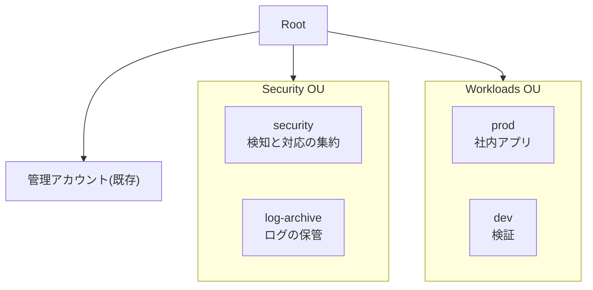

# 構築手順 P1:最小構成(マルチアカウント・ID基盤・検知・自動対応)

| 項目 | 内容 |
|---|---|
| フェーズ | P1(DOC-01 11章)。応募(12月上旬)までに完成させる |
| 関係する要件 | FR-ID-01〜05, 09、FR-DT-01〜06, 08, 09、FR-RS-01, 02, 05〜07、FR-LG-02 |
| 進め方 | 4つのセクションに分け、1つずつ「コード → plan の確認 → apply → 記録」を繰り返す |

## セクションの全体像
| # | セクション | Terraform | 作るもの | 面接で語れること |
|---|---|---|---|---|
| P1-1 | **マルチアカウントと組織のルール** | `terraform/org` | OU 2つ、アカウント4つ、SCP 5つ | アカウントを分ける理由、SCP で「やってはいけないこと」を仕組みで禁止 |
| P1-2 | ID 基盤をコードに取り込む | `terraform/identity` | P0 で手動で作った Identity Center の取り込み、グループ・許可セットの追加 | 手作業をコードに寄せる、最小権限 |
| P1-3 | ログと検知 | `terraform/logging`、`terraform/detection` | 組織の CloudTrail、ログ用 S3(オブジェクトロック)、GuardDuty、Security Hub、Config、Access Analyzer、予防的な基本設定 | 「侵害される前提」で、気づける仕組みを作る |
| P1-4 | 通知と自動対応 | `terraform/response` | EventBridge、Lambda(通知・SG の自動修復)、SNS | 人の注意力に頼らない |

**費用の注意:** GuardDuty と Security Hub は P1-3 で有効にした日から30日の無料トライアルが始まる。開始日を `ops-log` に書く。

---

## P1-1:マルチアカウントと組織のルール

### 作るもの


| SCP | 付ける場所 | 内容 | 要件 |
|---|---|---|---|
| `deny-leave-org` | Root | 組織から抜けることを禁止 | FR-DT-06 |
| `region-restrict` | Security OU、Workloads OU | 東京リージョン以外の利用を禁止(グローバルサービスは除く) | FR-DT-06 |
| `protect-security` | Security OU、Workloads OU | CloudTrail・GuardDuty・Security Hub・Config・Access Analyzer の停止と削除を禁止 | FR-DT-06, 09 |
| `deny-iam-user` | Security OU、Workloads OU | IAM ユーザー・アクセスキー・パスワードの作成を禁止 | FR-DT-09, FR-ID-04 |
| `protect-logs` | log-archive アカウント | ログ用 S3 の削除、オブジェクトロック・バケットポリシーの変更を禁止 | FR-LG-02 |

- `protect-security` と `protect-logs` は、Terraform が使う `OrganizationAccountAccessRole` だけを例外にする(例外がないと、Terraform 自身が設定を変えられない)
- SCP は管理アカウントには効かない。そのため管理アカウントは普段使わない(DOC-03 4.2)

### 事前に決めること:アカウントのメールアドレス
各アカウントのルートユーザーには、別々のメールアドレスが必要です。Gmail の「+」の別名を使います(届くのは同じ受信箱)。

| アカウント | メールアドレスの例 |
|---|---|
| security | `自分のGmail+aws-security@gmail.com` |
| log-archive | `自分のGmail+aws-log@gmail.com` |
| prod | `自分のGmail+aws-prod@gmail.com` |
| dev | `自分のGmail+aws-dev@gmail.com` |

- アドレスは `terraform/org/terraform.tfvars`(Git に入らない)にだけ書く
- 作られたアカウントのルートユーザーにはパスワードがない。使うことはないが、必要になったらパスワードの再設定で使える

### 手順
1. **組織の今の設定を確かめる**(信頼しているサービスを消さないため)
   ```bash
   aws organizations list-aws-service-access-for-organization --profile minato-mgmt
   ```
2. **変数ファイルとバックエンドの設定を作る**
   ```bash
   cd terraform/org
   cp terraform.tfvars.example terraform.tfvars
   cp ../bootstrap/backend.hcl backend.hcl
   ```
3. **既にある組織を Terraform に取り込む**
   ```bash
   export AWS_PROFILE=minato-mgmt
   terraform init -backend-config=backend.hcl
   terraform import aws_organizations_organization.this "$(aws organizations describe-organization --query Organization.Id --output text)"
   ```
4. **plan を読む。** 次のことを確かめる
   - 組織(`aws_organizations_organization.this`)は **変更だけ**(削除・作り直しがない)。信頼するサービスが **増えるだけ** で、減っていない
   - アカウントが4つ、OU が2つ、SCP が5つと、その付け先が作られる
5. **apply する。** アカウントの作成には数分かかる
6. **確かめる**
   - `aws organizations list-accounts` に4つのアカウントが `ACTIVE` で出る
   - SCP が効いているか:管理アカウントから `OrganizationAccountAccessRole` で dev アカウントに入り、次を試す
     | 試験 | 期待する結果 |
     |---|---|
     | `aws iam create-user` | `explicit deny in a service control policy` で拒否 |
     | `aws ec2 describe-vpcs --region us-west-2` | 拒否 |
     | `aws ec2 describe-vpcs --region ap-northeast-1` | 使える |
   - **書き込みを伴う試験の注意(実際に失敗した):** AssumeRole に失敗すると、管理アカウントのまま試験が動いてしまう。管理アカウントには SCP が効かないので、本当に作られてしまう。試験はスクリプトにし、`set -euo pipefail` を付け、`aws sts get-caller-identity` で dev にいることを確かめてから実行する。zsh では `$DEV:role` が修飾子として解釈されるため、変数は `${DEV}` と書く(ops-log の P1 のインシデントを参照)

### 削除するときの注意
- アカウントには `prevent_destroy` を付けている。削除するときは外してから `terraform destroy` する(DOC-04 OP-43)
- `close_on_deletion = true` のため、削除するとアカウントは閉鎖される(90日間は再開できる)

---

## P1-2:ID 基盤をコードに取り込む

### 作るもの
| まとまり | 内容 |
|---|---|
| 取り込み(import) | P0 で手動で作った `g-it-admin`、自分の所属、`AdministratorAccess` とそのポリシー、管理アカウントへの割り当て |
| グループ | `g-executive`、`g-developer`、`g-sales`、`g-backoffice`、`g-contractor` |
| 許可セット | `ReadOnlyAccess`、`Developer`(PowerUserAccess。IAM は操作できない)、`DashboardViewer`(このプロジェクトのダッシュボードの閲覧だけ) |
| 割り当て | 下の表 |

| グループ | 管理 | security | log-archive | prod | dev |
|---|---|---|---|---|---|
| g-it-admin | 管理者 | 管理者 | 管理者 | 管理者 | 管理者 |
| g-executive | ― | ダッシュボード閲覧 | ― | ― | ― |
| g-developer | ― | ― | ― | 読み取り | 開発者 |
| g-sales、g-backoffice、g-contractor | ― | ― | ― | ― | ― |

- 営業・経理・外部委託者には AWS の権限を渡さない。使うのは社内アプリだけで、P2 の ZTNA で制御する(最小権限)
- MFA の設定(FIDO2 のみ)は Terraform で管理できないため、画面で設定したままにする

### 手順
1. 変数ファイルとバックエンドの設定を作る
   ```bash
   cd terraform/identity
   cp terraform.tfvars.example terraform.tfvars
   cp ../bootstrap/backend.hcl backend.hcl
   ```
2. 初期化して、手動で作ったものを取り込む。ID はスクリプトがその場で調べる
   ```bash
   export AWS_PROFILE=minato-mgmt
   terraform init -backend-config=backend.hcl
   bash ../../scripts/import-identity.sh <Identity Center のユーザー名>
   ```
3. plan を読む。**取り込んだ5つは「変更」だけ**(説明文とタグの追加)で、削除・作り直しがないことを確かめる。自分の管理者権限が消えないことが一番大事
4. apply する
5. 新しいアカウントに SSO で入れるか確かめる。`~/.aws/config` に、アカウントごとのプロファイル(`minato-security` など)を足す
   ```ini
   [profile minato-dev]
   sso_session = minato
   sso_account_id = <dev のアカウントID>
   sso_role_name = AdministratorAccess
   region = ap-northeast-1
   ```
   ```bash
   aws sts get-caller-identity --profile minato-dev
   ```
6. SSO の管理者権限でも、SCP で IAM ユーザーを作れないことを確かめる(dev にいることを確かめてから試す)

### CI に足すときの注意
- Identity Center の ID ストアの ID(`d-xxxx`)は、アクセスポータルの URL と同じ文字列。plan のログに出るため、ワークフローで `::add-mask::` する

---

## P1-3:ログと検知

P1-3 は2つの PR に分ける。

| PR | スタック | 作るもの |
|---|---|---|
| P1-3a | `terraform/baseline`、`terraform/logging` | 全アカウントの予防的な基本設定、CI 用の読み取り専用ロール、ログ用 S3、組織の CloudTrail |
| P1-3b | `terraform/detection` | GuardDuty、Security Hub CSPM、Config、IAM Access Analyzer |

### P1-3a:基本設定とログ

#### 作るもの
| スタック | アカウント | 内容 |
|---|---|---|
| baseline | 5つすべて | IMDSv2 の必須化、アカウント単位の S3 パブリックアクセスのブロック、EBS の暗号化(FR-DT-08) |
| baseline | メンバー4つ | CI 用の読み取り専用ロール `zero-trust-minato-plan-readonly`(GitHub Actions の plan ロールからだけ引き受けられる) |
| logging | log-archive | ログ用 S3:オブジェクトロック(GOVERNANCE、1年)、バージョニング、SSE-S3、HTTP の拒否、書き込みは CloudTrail と Config だけ |
| logging | 管理 | 組織の CloudTrail:全アカウント・全リージョン・ログファイルの検証あり |
| bootstrap(変更) | 管理 | CI のロールに、メンバーの読み取り専用ロールを引き受ける権限を追加 |
| org(変更) | ― | SCP の protect-logs に `s3:BypassGovernanceRetention` の禁止を追加 |

#### 設計の判断
- **オブジェクトロックは GOVERNANCE + SCP。** COMPLIANCE はルートユーザーでも1年間消せず、片付けられなくなる。GOVERNANCE の解除の権限(`s3:BypassGovernanceRetention`)を SCP で禁止すれば、実質的に Terraform 用のロール以外は消せない
- **ログを安いストレージに移さない。** CloudTrail のログは小さく、最小 128KB 分の料金がかかるストレージに移すとかえって高くなる
- **組織の CloudTrail は全リージョン。** SCP で禁止したリージョンでの操作の「試み」も記録するため

#### 手順
1. 各スタックで `terraform.tfvars`(`management_account_id`)と `backend.hcl` を用意し、`terraform init -backend-config=backend.hcl`
2. bootstrap → org → baseline → logging の順に plan を読み、apply する
3. 確かめる
   ```bash
   aws cloudtrail get-trail-status --name zero-trust-minato-org-trail --profile minato-mgmt
   aws ec2 get-instance-metadata-defaults --profile minato-dev
   aws ec2 get-ebs-encryption-by-default --profile minato-dev
   ```
   - `IsLogging` が `true`、IMDS が `required`、EBS の暗号化が `true`
   - 数分後、ログ用 S3 の `AWSLogs/<組織ID>/` の下にログが届いていること

#### CI に足すときの注意
- メンバーアカウントでは、`TF_VAR_member_role_name=zero-trust-minato-plan-readonly` を渡して、読み取り専用ロールで plan する
- ログ用 S3 のバケット名がログに出るため、ワークフローで全アカウントのバケット名も `::add-mask::` する
